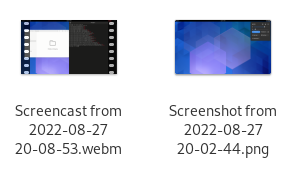

# Personnaliser les applications GNOME

Ce chapitre explique comment aborder les applications GNOME une par une. Il complète les chapitres GTK 3, GTK 4 et Libadwaita : un thème global agit sur les composants partagés, mais une application peut ajouter ses propres classes CSS, charger une feuille prioritaire, dessiner certains éléments elle-même ou utiliser des ressources spécifiques.

L'objectif est de savoir **ce qui peut être personnalisé**, **où chercher l'implémentation**, **comment tester une règle** et **comment documenter une limite**. Aucun sélecteur présenté ici ne doit être supposé universel : il faut toujours le confirmer dans la version de l'application installée.



Cette capture documente GNOME Fichiers. Elle illustre une application réelle ; elle ne décrit pas à elle seule les styles internes de toutes les applications GTK. Certaines applications n'ont pas de barre latérale, utilisent une barre d'outils différente ou dessinent leur contenu avec des composants spécialisés.

## 1. Comprendre les couches d'une application

Une fenêtre GNOME peut combiner plusieurs couches :

1. **GTK** fournit les widgets de base : fenêtre, bouton, champ, liste, défilement.
2. **Libadwaita** fournit des composants et des conventions visuelles supplémentaires.
3. **L'application** assemble ces widgets et peut leur ajouter des classes CSS.
4. **Les ressources** fournissent les icônes, illustrations, polices et images.
5. **Les préférences** déterminent le comportement, par exemple l'affichage d'une barre latérale.

Une règle appliquée à `button` peut donc changer plusieurs applications, tandis qu'une classe spécifique peut ne concerner qu'une seule application. Inversement, une application peut utiliser un dessin personnalisé qui n'est pas un widget CSS standard.

### Identifier la technologie utilisée

Commencez par identifier le processus et ses bibliothèques. Les commandes suivantes donnent des indices, mais ne remplacent pas l'inspection de l'application :

```sh
# Rechercher le processus d'une application
pgrep -a nautilus

# Voir les bibliothèques GTK/Adwaita chargées par un processus
grep -E 'libgtk-3|libgtk-4|libadwaita' /proc/$(pgrep -n nautilus)/maps
```

Adaptez le nom du processus. Si plusieurs instances existent, choisissez le PID correspondant à la fenêtre étudiée. L'accès à `/proc/PID/maps` peut être limité par les permissions ou les paramètres de sécurité.

Autre méthode : consultez les dépendances du paquet de l'application avec le gestionnaire de paquets de votre distribution. Ne concluez pas qu'une application utilise Libadwaita uniquement parce que son apparence ressemble à GNOME moderne.

## 2. Méthode commune pour personnaliser une application

Appliquez cette procédure avant d'écrire du CSS :

1. Notez le nom et la version de l'application.
2. Identifiez GTK 3, GTK 4 et, si applicable, Libadwaita.
3. Ouvrez une fenêtre représentative et repérez la zone à modifier.
4. Activez l'inspecteur GTK si l'application l'autorise.
5. Sélectionnez le nœud correspondant au composant.
6. Notez son type, ses classes, ses identifiants, ses parents et ses états.
7. Ajoutez une règle temporaire très visible pour confirmer le sélecteur.
8. Remplacez cette règle de diagnostic par le style final.
9. Vérifiez les autres fenêtres et dialogues de la même application.
10. Vérifiez les variantes clair/sombre, les textes longs, la navigation clavier et le facteur d'échelle.

Ne commencez pas par un sélecteur global comme `* {`. Il rend difficile l'identification des effets secondaires et peut dégrader les champs, les icônes, les menus ou les composants internes.

## 3. GNOME Files (Nautilus)

Nautilus combine généralement une fenêtre GTK 4/Libadwaita, une barre d'en-tête, une barre latérale, une zone de contenu, des vues de fichiers et des menus.

### Zones à examiner

- Barre d'en-tête : titre, navigation, recherche, boutons et menus.
- Barre latérale : emplacements, périphériques, favoris et réseau.
- Barre de chemin : emplacement courant et segments de navigation.
- Zone de fichiers : icônes, noms, grilles, listes et sélection.
- Menus contextuels : fichiers, dossiers, arrière-plan et périphériques.
- Dialogues : ouverture, enregistrement, propriétés et renommage.
- États : chargement, dossier vide, erreur, permission refusée et périphérique absent.

### Exercice : identifier puis styliser une ligne de fichier

1. Ouvrez un dossier contenant plusieurs fichiers.
2. Passez en vue liste si elle est disponible.
3. Inspectez une ligne non sélectionnée, puis une ligne sélectionnée.
4. Identifiez séparément le conteneur, le nom, les informations secondaires et l'icône.
5. Testez une couleur de fond temporaire sur le conteneur identifié.
6. Vérifiez que la sélection, le focus clavier et le survol restent distincts.

Exemple de règle **illustrative**, à adapter au nœud réellement inspecté :

```css
/* Exemple GTK : ne pas supposer que .file-row existe dans toutes les versions. */
.file-row {
  border-radius: 8px;
  padding: 4px 8px;
}

.file-row:selected {
  background-color: alpha(@accent_bg_color, 0.22);
}
```

Si le sélecteur ne correspond à rien, ne le conservez pas : retournez à l'inspecteur et relevez la classe réelle. Les noms de classes internes de Nautilus ne constituent pas une API stable.

## 4. GNOME Control Center (Paramètres)

Paramètres regroupe de nombreuses pages et utilise des composants de préférences. Ne confondez pas la présentation d'une préférence avec le réglage qu'elle contrôle.

### Familles d'écrans

- Accueil et catégories.
- Réseau et Wi-Fi.
- Bluetooth.
- Son et périphériques audio.
- Écrans et affichage.
- Apparence.
- Applications par défaut.
- Notifications.
- Recherche.
- Multitâche.
- Comptes en ligne.
- Confidentialité et sécurité.
- Partage.
- Clavier et raccourcis.
- Souris et pavé tactile.
- Accessibilité.
- Date, heure et région.
- Utilisateurs et système.

La disponibilité des pages dépend des composants installés, de la distribution et des permissions.

### Personnaliser une ligne de préférence

Une ligne peut contenir un titre, une description, un contrôle principal, une icône et un contrôle secondaire. Inspectez ces sous-éléments séparément. Un style appliqué à toute la ligne ne doit pas rendre le commutateur ou le texte secondaire illisible.

Vérifications obligatoires :
- titre et description longs ;
- option désactivée ou indisponible ;
- interrupteur activé et désactivé ;
- focus clavier ;
- page étroite et page large ;
- message d'erreur ou avertissement ;
- mode clair et sombre.

Le thème ne doit pas modifier la valeur de la préférence. Les paramètres fonctionnels relèvent de GSettings ou de l'application, pas du CSS.

## 5. GNOME Calendar

Les zones à examiner sont la barre d'en-tête, la navigation temporelle, les vues mois/semaine/jour, les événements, les calendriers, les couleurs de catégories et les dialogues de création ou modification.

Testez au minimum :
- journée avec aucun événement ;
- événement court et événement long ;
- événements qui se chevauchent ;
- plusieurs calendriers ;
- événement sur plusieurs jours ;
- changement de mois et de semaine ;
- texte traduit et fuseau horaire différent ;
- événement sélectionné et événement en cours.

Les couleurs des calendriers peuvent être des données configurables par l'utilisateur. Un thème global ne doit pas les remplacer arbitrairement. Le contraste entre texte et couleur d'événement doit rester suffisant.

## 6. GNOME Console et GNOME Terminal

Ces applications ne doivent pas être traitées comme des fenêtres GTK ordinaires uniquement.

La zone terminal possède son propre rendu du texte, des couleurs ANSI, du curseur et de la sélection. La personnalisation peut dépendre des préférences de profil de l'application plutôt que du thème GTK.

À distinguer :
- fond de la fenêtre et barre d'en-tête ;
- fond du terminal ;
- palette ANSI de 16 couleurs ou palette étendue ;
- couleur du texte ;
- curseur bloc, barre ou souligné ;
- sélection et texte sélectionné ;
- police monospace et ligatures ;
- clignotement du curseur ;
- transparence éventuelle.

Ne supposez pas qu'une règle CSS `color` change les couleurs du terminal. Configurez d'abord la palette dans les préférences de l'application, puis utilisez le CSS GTK uniquement pour les éléments GTK réellement exposés.

## 7. Autres applications GNOME à inclure dans les tests

Le nom et le paquet exact peuvent varier selon les distributions. Cette liste constitue une base de validation, pas une promesse que chaque application est installée :

- **GNOME Software** : listes d'applications, cartes, détails, captures, boutons d'installation, progression, sources et mises à jour.
- **GNOME Text Editor** : éditeur, numéros de ligne, minimap si disponible, recherche, onglets, coloration syntaxique et terminal intégré si présent.
- **GNOME Calculator** : affichage, clavier, historique, modes et menus.
- **GNOME Clocks** : horloges, alarmes, minuteur, chronomètre et fuseaux horaires.
- **GNOME Weather** : localisation, prévisions, températures, graphiques et états sans données.
- **GNOME Maps** : carte, contrôles, recherche, résultats, itinéraires et marqueurs. Le rendu cartographique peut être fourni par un moteur distinct du CSS GTK.
- **GNOME Photos** : grille, visionneuse, sélection, édition et métadonnées, selon la version distribuée.
- **GNOME Disks** : périphériques, partitions, graphiques, boîtes de dialogue et avertissements. Les opérations destructives doivent rester clairement identifiables.
- **GNOME System Monitor** : listes de processus, graphiques, colonnes, unités et états de charge.
- **GNOME Screenshot / outil de capture** : sélection de zone, contrôles, aperçu et actions, selon l'outil fourni par la version de GNOME.
- **Visionneur de documents** : pages, barre latérale, recherche, annotations et dialogues.
- **Gestionnaire d'archives** : listes, progression, extraction, erreurs et confirmation d'écrasement.

Pour chaque application, consignez le paquet, la version, le toolkit, les composants inspectés, les sélecteurs réellement observés et les limites. Ne recopiez pas les sélecteurs d'une version différente sans vérification.

## 8. Éléments qui ne sont pas contrôlés par le thème global

Un thème GTK ne garantit pas la modification :
- du contenu dessiné directement avec Cairo, OpenGL, Vulkan ou un moteur de rendu dédié ;
- des cartes et contenus web intégrés ;
- des palettes de terminal gérées par l'application ;
- des composants personnalisés qui n'exposent pas de nœuds CSS ;
- des feuilles CSS chargées avec une priorité supérieure ;
- des applications Qt, Electron ou utilisant un toolkit propriétaire ;
- des écrans privilégiés ou gérés par un autre utilisateur système.

Dans ces cas, recherchez les préférences et mécanismes officiels de l'application. N'injectez pas de CSS ou de code dans un processus pour contourner ses protections.

## 9. Fiche de documentation obligatoire pour chaque application

Pour considérer une application comme documentée, remplissez les points suivants dans une fiche dédiée :

- Nom affiché, nom du paquet et version testée.
- Toolkit et version de bibliothèque.
- Dépendance éventuelle à Libadwaita.
- Fenêtres, pages, dialogues et menus couverts.
- Arbre CSS ou capture de l'inspecteur pour les composants importants.
- Classes et sélecteurs observés, avec version.
- Exemples CSS vérifiés dans l'application.
- Paramètres visuels contrôlés par l'application elle-même.
- États testés : normal, survol, focus, actif, sélectionné, désactivé, erreur, chargement et vide.
- Variantes testées : clair, sombre, contraste élevé, HiDPI et RTL.
- Limites et procédure de retour arrière.

Une application ne doit être marquée comme « prise en charge » que lorsque les exemples ont été testés dans sa version indiquée. Si aucun test n'a été réalisé, afficher « à vérifier ».

## 10. Exercice final : créer une fiche Nautilus

Créez un fichier `nautilus.md` contenant :

1. La version de Nautilus testée.
2. Le toolkit identifié.
3. Une capture ou description de l'arbre CSS.
4. Les classes observées pour la barre d'en-tête, la barre latérale et une ligne de fichier.
5. Une règle de test puis sa version finale.
6. Le résultat en mode clair et sombre.
7. Les limites rencontrées.

Cet exercice est terminé lorsque vous pouvez expliquer pourquoi chaque règle touche le composant visé et démontrer qu'elle ne dégrade pas les autres zones de la fenêtre.


## 11. Relever l'environnement d'une application avant les essais

Le nom affiché dans le menu ne suffit pas à identifier le binaire, le paquet et le toolkit. Relevez ces informations avant d'interpréter un résultat :

```sh
app_pid="$(pgrep -n nautilus || true)"
if [[ -n "$app_pid" ]]; then
  printf 'PID : %s\n' "$app_pid"
  printf 'Exécutable : '
  readlink -f "/proc/$app_pid/exe"
  printf '\nBibliothèques graphiques :\n'
  grep -E '/lib(gtk|adwaita)' "/proc/$app_pid/maps" \
    | sed -E 's/.*(\/[^ ]+\.so[^ ]*).*/\1/' \
    | sort -u
else
  printf 'Nautilus ne semble pas être lancé.\n'
fi
```

Adaptez `nautilus` au nom réel du processus. Cette méthode observe les bibliothèques mappées par un processus natif. Elle ne donne pas toujours une réponse complète pour les applications sandboxées, les bibliothèques chargées tardivement ou les processus auxiliaires.

Pour un paquet Flatpak, identifiez d'abord l'application :

```sh
flatpak list --app
flatpak info org.gnome.Nautilus
```

Le second identifiant est un exemple courant ; utilisez l'identifiant réellement retourné par votre système. Les bibliothèques embarquées dans le runtime Flatpak peuvent différer des bibliothèques de l'hôte. Ne mélangez pas les conclusions d'un test Flatpak et d'un test natif.

## 12. Lancer une application de test sans réutiliser un processus existant

Une variable d'environnement passée à une commande ne modifie pas nécessairement un processus déjà lancé. Si l'application transmet la demande à une instance existante, l'inspecteur peut ne pas être activé sur cette instance.

Pour un test natif, fermez d'abord l'application et vérifiez qu'aucun processus concerné ne reste actif. Puis lancez-la depuis un terminal :

```sh
GTK_DEBUG=interactive nautilus --new-window
```

Les options disponibles varient selon l'application. Si elle ne propose pas de nouvelle fenêtre, démarrez-la depuis un compte de test ou utilisez le mécanisme documenté par son projet. Ne terminez pas brutalement un processus qui pourrait être en train d'écrire des données.

Pour un Flatpak, l'environnement doit être transmis à l'intérieur du sandbox. Par exemple :

```sh
flatpak run --env=GTK_DEBUG=interactive org.gnome.Nautilus
```

Vérifiez que l'identifiant existe avec `flatpak list --app`. L'inspecteur peut être absent du runtime ou désactivé dans la construction de l'application ; un échec n'indique pas que le thème CSS est incorrect.

## 13. Distinguer défaut de thème et défaut de données

Une interface GNOME varie selon son contenu. Avant de conclure qu'une règle est défectueuse, reproduisez l'état avec un jeu de données contrôlé.

Pour une liste de fichiers, préparez par exemple :
- un nom court et un nom très long ;
- des fichiers avec et sans miniature ;
- un dossier vide et un dossier contenant de nombreux éléments ;
- des noms avec accents et caractères non latins ;
- un fichier caché ;
- des éléments sélectionnés et non sélectionnés.

Pour les pages de préférences, testez un contrôle activé, désactivé, indisponible et en erreur. Pour un calendrier, utilisez des événements qui se chevauchent et des événements couvrant plusieurs jours. Pour une application de terminal, utilisez une sortie avec couleurs ANSI, une sélection, une ligne longue et un curseur dans chaque forme disponible.

Cette variation permet de distinguer une vraie régression CSS d'une différence de contenu, de traduction, de taille de fenêtre ou de configuration utilisateur.

## 14. Exemples de parcours de vérification par application

Les parcours ci-dessous décrivent des comportements à tester, pas des sélecteurs CSS garantis. Les libellés et fonctions peuvent évoluer selon la version installée.

### Fichiers

- Ouvrir un dossier local, un emplacement réseau si disponible et un périphérique amovible.
- Basculer entre les vues grille et liste.
- Tester sélection simple, sélection multiple, survol, focus et menu contextuel.
- Afficher les propriétés d'un fichier et le dialogue de renommage.
- Vérifier l'affichage pendant le chargement des miniatures et en cas d'accès refusé.

Le thème ne doit pas rendre indiscernables la sélection, le focus clavier et le survol. Le menu contextuel doit rester lisible lorsqu'il est ouvert sur une ligne sélectionnée.

### Paramètres

- Ouvrir plusieurs catégories qui utilisent des contrôles différents.
- Modifier un réglage réversible dans le compte de test, puis le restaurer.
- Vérifier les lignes de préférence avec description, interrupteur, bouton secondaire et avertissement.
- Tester les pages qui affichent des périphériques absents ou des services indisponibles.

Un thème ne doit pas donner l'apparence d'un réglage activé lorsque sa valeur réelle est désactivée. Le CSS ne doit jamais servir à simuler l'état fonctionnel d'un contrôle.

### Calendrier

- Changer de mois, de semaine et de jour.
- Afficher plusieurs calendriers et masquer l'un d'eux.
- Créer puis supprimer un événement de test.
- Vérifier les événements longs, chevauchants et sur plusieurs jours.
- Tester les couleurs personnalisées et le contraste du texte.

Les couleurs de calendrier sont des données de l'utilisateur. Le thème doit préserver leur sens et leur lisibilité plutôt que forcer une palette uniforme.

### Logiciels

- Examiner les vues découverte, recherche, détails et mises à jour.
- Vérifier les cartes avec et sans capture d'écran.
- Observer les boutons installer, annuler, lancer et supprimer selon les actions disponibles.
- Tester la progression, l'échec réseau et les sources désactivées si l'environnement le permet.

Ne réalisez pas d'installation ou de suppression de logiciel sur un environnement de production uniquement pour tester un état visuel. Utilisez une machine virtuelle ou un compte de test.

### Éditeur de texte

- Ouvrir un fichier court puis un fichier volumineux.
- Activer et désactiver la coloration syntaxique.
- Afficher la recherche, le remplacement, les onglets et les dialogues.
- Vérifier la sélection, le curseur, les numéros de ligne et les messages d'erreur.

La zone de texte peut être rendue par un composant spécialisé. Les couleurs de syntaxe et le curseur ne sont pas nécessairement contrôlés par le CSS global GTK.

### Terminal

- Vérifier la palette ANSI et les couleurs à fort contraste.
- Tester la sélection et le texte sélectionné.
- Afficher une ligne plus large que la fenêtre et faire défiler l'historique.
- Tester les états du curseur et la police monospace.
- Ouvrir et fermer les préférences de profil.

La palette du terminal doit être configurée dans l'application. N'utilisez pas le CSS de la fenêtre pour prétendre contrôler le rendu du terminal lui-même.

## 15. Tester les applications après une mise à jour

Une mise à jour peut changer le toolkit, la version de Libadwaita, les classes CSS ou la hiérarchie des widgets sans modifier fortement l'apparence par défaut. Après chaque mise à jour importante :

1. relevez la nouvelle version du paquet ;
2. vérifiez les bibliothèques réellement chargées ;
3. réinspectez les composants dont le thème dépend ;
4. vérifiez que les sélecteurs ciblés existent toujours ;
5. rejouez les états interactifs et les variantes ;
6. comparez les captures à taille et facteur d'échelle identiques ;
7. retirez les règles devenues inutiles ou trop larges ;
8. consignez les changements de compatibilité.

Ne conservez pas un sélecteur simplement parce qu'il n'émet aucune erreur : une règle sans correspondance peut être silencieusement ignorée. La validation doit confirmer que le composant ciblé reçoit réellement le style attendu.

## 16. Modèle de compte rendu d'essai

Copiez ce modèle dans le dossier de tests du thème et remplissez-le pour chaque application réellement couverte :

```text
Application :
Identifiant paquet :
Version :
Origine : paquet système / Flatpak / autre
Session : Wayland / X11
GTK chargé :
Libadwaita chargée :
Taille de fenêtre :
Facteur d'échelle :
Variante : clair / sombre / contraste renforcé
Composants parcourus :
États vérifiés :
Sélecteurs confirmés :
Propriétés vérifiées :
Défauts :
Limites :
Résultat : réussi / partiel / échec / non testé
Date et environnement :
```

Ne transformez pas un modèle vide en déclaration de compatibilité. Une application est « prise en charge » uniquement si le compte rendu contient une version précise, des composants identifiés et des essais réellement réalisés.
