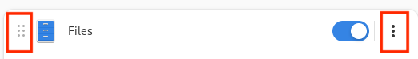
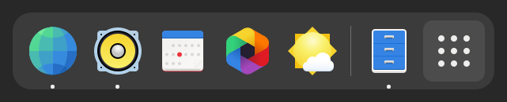

# Comprendre et personnaliser la vue Activités de GNOME Shell 51



Cette capture officielle complète la vue du lanceur en montrant le classement des résultats de recherche.


Ce chapitre explique la vue d'ensemble affichée avec la touche Super ou le bouton Activités. Il distingue les fenêtres, les espaces de travail, la recherche, le Dash et la grille d'applications. Les repères CSS ci-dessous ont été vérifiés dans les sources amont GNOME Shell **51.0**. Ils décrivent l'implémentation de cette version, pas une API stable.



Sources amont :
- [overview.js](https://github.com/GNOME/gnome-shell/blob/51.0/js/ui/overview.js)
- [overviewControls.js](https://github.com/GNOME/gnome-shell/blob/51.0/js/ui/overviewControls.js)
- [workspacesView.js](https://github.com/GNOME/gnome-shell/blob/51.0/js/ui/workspacesView.js)
- [workspace.js](https://github.com/GNOME/gnome-shell/blob/51.0/js/ui/workspace.js)
- [workspaceThumbnail.js](https://github.com/GNOME/gnome-shell/blob/51.0/js/ui/workspaceThumbnail.js)
- [dash.js](https://github.com/GNOME/gnome-shell/blob/51.0/js/ui/dash.js)
- [appDisplay.js](https://github.com/GNOME/gnome-shell/blob/51.0/js/ui/appDisplay.js)
- [SCSS du Dash](https://github.com/GNOME/gnome-shell/blob/51.0/data/theme/gnome-shell-sass/widgets/_dash.scss)
- [SCSS de la grille d'applications](https://github.com/GNOME/gnome-shell/blob/51.0/data/theme/gnome-shell-sass/widgets/_app-grid.scss)
- [SCSS des fenêtres](https://github.com/GNOME/gnome-shell/blob/51.0/data/theme/gnome-shell-sass/widgets/_window-picker.scss)
- [SCSS de la recherche](https://github.com/GNOME/gnome-shell/blob/51.0/data/theme/gnome-shell-sass/widgets/_search-entry.scss)

## 1. La vue Activités n'est pas une fenêtre ordinaire

La vue Activités est une interface du Shell, construite avec St et Clutter. Elle affiche des acteurs représentant les fenêtres, les espaces de travail et les lanceurs. Les fenêtres visibles sont des aperçus des fenêtres existantes : ce ne sont pas des captures d'écran statiques à décorer indépendamment.

Dans GNOME Shell 51.0, `overview.js` instancie un `OverviewActor` et lui associe un `ControlsManager`. Ce dernier assemble les contrôles et les différentes vues. Le CSS change l'apparence des acteurs présents, mais ne réorganise pas à lui seul les interactions ou la logique de navigation.

## 2. Comprendre les zones visuelles

La capture permet de repérer les grandes zones :

- **Panneau supérieur** : reste présent dans la vue et adopte un état de style particulier.
- **Recherche** : champ central permettant de lancer une recherche et d'afficher les résultats des fournisseurs.
- **Aperçus de fenêtres** : représentations interactives des fenêtres du bureau courant.
- **Espaces de travail** : miniatures latérales qui permettent de choisir un bureau et de déplacer des fenêtres.
- **Dash** : barre de favoris et d'applications en cours.
- **Afficher les applications** : bouton du Dash qui ouvre la grille d'applications.

La disposition réelle dépend de la résolution, du nombre de fenêtres, du nombre d'espaces de travail, du nombre d'écrans et de l'état courant de la vue.

## 3. Fond de la vue : `#overviewGroup`

Le SCSS de GNOME Shell 51.0 déclare :

```css
#overviewGroup
```

Ce conteneur reçoit le fond de la vue. Il ne faut pas le confondre avec le fond du bureau, ni avec le fond des fenêtres miniatures.

Exemple :

```css
#overviewGroup {
  background-color: #202735;
}
```

Ce changement est volontairement simple. Si le fond du bureau reste visible ou si un effet de flou est appliqué, cela dépend aussi des acteurs de fond et de la transition pilotés par le Shell. Une couleur CSS sur `#overviewGroup` ne remplace pas la logique d'arrière-plan.

## 4. La recherche : `.search-entry`

Le champ de recherche est créé par `overviewControls.js` avec la classe `search-entry`. Le fichier SCSS correspondant définit sa largeur, ses marges, ses coins arrondis et l'icône interne `.search-entry-icon`.

Exemple :

```css
.search-entry {
  width: 28em;
  border-radius: 999px;
  margin-top: 12px;
  margin-bottom: 8px;
  padding: 8px 14px;
}

.search-entry .search-entry-icon {
  icon-size: 18px;
}
```

La largeur est exprimée en em pour suivre l'échelle typographique. Évitez de fixer une largeur en pixels qui devient trop grande ou trop petite avec une autre échelle d'affichage.

### Les résultats de recherche

Les résultats ne sont pas un simple texte dans le champ. Le code de `search.js` crée des sections et des éléments distincts. Les classes présentes dans le code 51.0 comprennent notamment :

- `.search-display` : conteneur des résultats ;
- `.search-section` : section d'un fournisseur ;
- `.search-section-separator` : séparation entre sections ;
- `.search-section-content` : contenu d'une section ;
- `.list-search-results` : résultats sous forme de liste ;
- `.grid-search-results` : résultats sous forme de grille ;
- `.list-search-result-title` : titre d'un résultat ;
- `.list-search-result-description` : description ;
- `.search-provider-icon` : icône du fournisseur.

Exemple de style léger :

```css
.search-section {
  border-radius: 12px;
  padding: 8px;
}

.list-search-result-title {
  font-weight: 700;
}

.list-search-result-description {
  color: #c7cbd3;
}
```

Ces règles peuvent affecter plusieurs fournisseurs. Vérifiez la lisibilité des descriptions longues et la sélection au clavier. Le thème ne décide pas quels fournisseurs sont installés ni quels résultats ils renvoient.

## 5. Les aperçus de fenêtres : `.window-picker`

Le code de `workspace.js` crée les aperçus de fenêtres. La feuille SCSS `_window-picker.scss` contient les sélecteurs :

- `.window-picker` : zone de présentation des fenêtres ;
- `.window-icon` : icône associée à une fenêtre ;
- `.window-caption` : titre affiché avec l'aperçu ;
- `.window-close` : bouton de fermeture ;
- `.workspace-background` : fond du bureau représenté.

Exemple :

```css
.window-picker {
  spacing: 18px;
}

.window-caption {
  color: #ffffff;
  font-weight: 600;
}

.window-close {
  border-radius: 999px;
}
```

Le moteur St n'implémente pas toutes les propriétés CSS du navigateur. La propriété `spacing` s'applique aux conteneurs St concernés ; elle n'est pas une propriété CSS web générique.

Les aperçus ont des états de survol, de sélection et de focus. Vérifiez le bouton de fermeture, le clic sur l'aperçu, le déplacement par glisser-déposer et la navigation au clavier. N'augmentez pas trop les marges : le gestionnaire de disposition calcule la taille des aperçus selon l'espace disponible.

## 6. Les miniatures d'espaces de travail

Le code de `workspaceThumbnail.js` crée les miniatures et leur conteneur. Les classes repérées dans GNOME Shell 51.0 sont :

- `.workspace-thumbnails` : conteneur de la colonne de miniatures ;
- `.workspace-thumbnail` : miniature individuelle ;
- `.workspace-thumbnail-indicator` : indicateur de l'espace actif ;
- `.placeholder` : emplacement temporaire pendant certaines opérations de déplacement.

Exemple :

```css
.workspace-thumbnails {
  spacing: 12px;
}

.workspace-thumbnail {
  border-radius: 10px;
}

.workspace-thumbnail-indicator {
  border: 2px solid #78aeed;
  border-radius: 12px;
}
```

Ne confondez pas les miniatures latérales avec les grandes surfaces d'espaces de travail qui contiennent les aperçus de fenêtres. Elles sont construites par des classes différentes et leur taille est calculée par le code.

Testez un, deux puis plusieurs espaces de travail. Vérifiez le changement de bureau, le glisser-déposer d'une fenêtre, l'ajout et la suppression dynamique de bureaux et la présence de plusieurs écrans.

## 7. Le Dash : `#dash`

Le Dash est la barre des applications favorites et des applications ouvertes. Le SCSS de GNOME Shell 51.0 définit `#dash`, `.dash-background`, `.dash-item-container`, `.dash-separator` et `.dash-label`.

Exemple :

```css
#dash .dash-background {
  background-color: rgba(24, 28, 36, 0.92);
  border-radius: 20px;
  padding: 12px;
}

#dash .dash-separator {
  background-color: rgba(255, 255, 255, 0.25);
  width: 1px;
}

#dash .dash-label {
  border-radius: 8px;
}
```

Les éléments du Dash utilisent aussi `.overview-tile` et `.overview-icon`. Le SCSS cible explicitement les états `:focus`, `:hover`, `:active` et `:checked`. Il faut donc personnaliser les quatre états, pas seulement l'apparence normale.

```css
#dash .overview-tile:hover .overview-icon {
  background-color: rgba(255, 255, 255, 0.12);
}

#dash .overview-tile:focus .overview-icon {
  outline: 2px solid #78aeed;
  outline-offset: 2px;
}

#dash .overview-tile:active .overview-icon,
#dash .overview-tile:checked .overview-icon {
  background-color: rgba(120, 174, 237, 0.25);
}
```

Le point d'application en cours est représenté par `.app-grid-running-dot`. Il ne faut pas le confondre avec le point d'espace de travail du panneau.

## 8. La grille d'applications

La grille utilise la classe `.icon-grid`. Le SCSS natif lui applique des propriétés St spécifiques :

- `row-spacing` et `column-spacing` pour l'espacement entre les icônes ;
- `max-row-spacing` et `max-column-spacing` pour les limites d'espacement ;
- `page-padding-top`, `page-padding-bottom`, `page-padding-left` et `page-padding-right` pour les marges de page.

Exemple :

```css
.icon-grid {
  row-spacing: 24px;
  column-spacing: 28px;
  max-row-spacing: 40px;
  max-column-spacing: 44px;
  page-padding-top: 28px;
  page-padding-bottom: 28px;
  page-padding-left: 24px;
  page-padding-right: 24px;
}
```

Les icônes et tuiles utilisent notamment `.overview-tile`, `.overview-icon`, `.app-folder`, `.app-grid-running-dot`, `.page-indicator` et `.page-navigation-arrow`.

Exemple :

```css
.overview-tile {
  border-radius: 18px;
  padding: 12px;
}

.overview-tile .overview-icon {
  icon-size: 64px;
}

.app-folder {
  border-radius: 18px;
}

.page-indicator .page-indicator-icon {
  border-radius: 999px;
}
```

Le dimensionnement réel des icônes peut aussi dépendre du code de grille et de l'espace disponible. Une taille très élevée peut provoquer des pages supplémentaires et des déplacements inattendus.

## 9. Les dossiers d'applications

Les dossiers sont ciblés par `.app-folder`. Leur fenêtre développée utilise `.app-folder-dialog` et son conteneur `.app-folder-dialog-container`. Le nom du dossier est géré par `.folder-name-container`, `.folder-name-label` et `.folder-name-entry`.

Exemple :

```css
.app-folder-dialog {
  border-radius: 24px;
  background-color: #292e38;
  color: #f6f5f4;
}

.app-folder-dialog .folder-name-container {
  padding: 24px 32px;
}
```

Le nom et le contenu du dossier sont gérés par les paramètres du Shell. Le CSS ne crée pas de dossier et ne modifie pas l'ordre des applications.

## 10. Les propriétés St qui ne sont pas du CSS de navigateur

La grille d'applications utilise des propriétés propres aux widgets St. Les propriétés `row-spacing`, `column-spacing`, `max-row-spacing`, `page-padding-*` et `icon-size` doivent être vérifiées dans la documentation St correspondant à GNOME Shell 51.

Une feuille qui passe dans un validateur CSS web peut signaler ces propriétés comme inconnues. Cela ne signifie pas qu'elles sont invalides dans St. Inversement, une propriété CSS web acceptée par un navigateur n'est pas nécessairement implémentée par St.

## 11. Méthode d'essai progressive

1. Sauvegardez le thème fonctionnel.
2. Modifiez uniquement le fond de `#overviewGroup`.
3. Ouvrez Activités et contrôlez le contraste.
4. Modifiez la largeur et les marges de `.search-entry`.
5. Ouvrez une recherche avec plusieurs fournisseurs.
6. Ajoutez deux fenêtres puis quatre fenêtres.
7. Testez le titre, la fermeture et le focus des aperçus.
8. Ajoutez plusieurs espaces de travail.
9. Personnalisez le Dash et les états des tuiles.
10. Ouvrez la grille, changez de page et ouvrez un dossier.
11. Répétez à 100 %, 150 % et 200 % d'échelle si disponible.
12. Répétez en session claire, sombre et contraste élevé.

## 12. Problèmes fréquents

**La recherche ne change pas.** Vérifiez que le sélecteur est `.search-entry`, puis inspectez le champ réel. Le style du champ et celui des résultats sont deux parties différentes.

**Les fenêtres débordent.** Réduisez les espacements et les marges. Ne forcez pas des dimensions fixes sur chaque aperçu.

**Les miniatures sont minuscules.** La taille est calculée par le Shell en fonction de l'écran et du nombre de bureaux. Commencez par les espacements et les bordures avant de chercher à forcer la géométrie.

**Le Dash perd son focus.** Contrôlez `:focus` sur la tuile et son enfant `.overview-icon`. Le style du conteneur seul ne suffit pas.

**La grille affiche plusieurs pages.** Le nombre de pages dépend de l'espace disponible, du nombre d'applications et de la géométrie de la grille.

## 13. Exercices

### Exercice A — vue lisible

Changez le fond de la vue, la largeur de recherche et le style du champ. Testez une recherche réelle et le déplacement au clavier.

### Exercice B — fenêtres

Ouvrez trois applications. Personnalisez les titres, le bouton de fermeture et les espacements. Déplacez une fenêtre vers un autre espace de travail.

### Exercice C — Dash

Modifiez le fond, les coins, le séparateur et les états des icônes. Vérifiez que les applications favorites et les applications ouvertes restent identifiables.

### Exercice D — grille

Modifiez les espacements de grille, le style des dossiers et les indicateurs de page. Testez une grille remplie et une grille avec peu d'applications.

## 14. Limites et règles de maintenance

- Les sélecteurs décrivent GNOME Shell 51.0 et peuvent évoluer.
- Une extension peut remplacer le Dash ou ajouter ses propres classes.
- Les thèmes Shell ne stylent pas automatiquement les fenêtres GTK et Libadwaita.
- Les écrans de connexion et de verrouillage ont des contextes et privilèges distincts.
- Les effets de transition et la géométrie sont contrôlés en partie par JavaScript.
- Ne masquez pas les repères de focus et ne réduisez pas les cibles interactives à des tailles difficiles à utiliser.

Pour chaque nouvelle version de GNOME, comparez les fichiers SCSS et JavaScript amont avant de réutiliser les sélecteurs.


## 15. Préparer une campagne de test complète

La vue Activités change fortement selon le contenu du bureau. Un test limité à un bureau vide ne permet pas de valider le Dash, les aperçus, les miniatures ou la grille.

Préparez un environnement de test avec :
- une fenêtre maximisée ;
- deux fenêtres qui se chevauchent ;
- une fenêtre réduite ou minimisée ;
- plusieurs applications ouvertes ;
- au moins trois espaces de travail ;
- des applications favorites et non favorites ;
- un dossier contenant plusieurs applications ;
- une recherche donnant des résultats de plusieurs fournisseurs.

Notez la résolution, le facteur d'échelle, le nombre d'écrans, leur disposition et la version exacte de GNOME Shell. Ne changez qu'une variable entre deux captures de référence.

### Scénario de référence

1. Démarrez sur un bureau sans fenêtre au premier plan.
2. Ouvrez la vue Activités avec Super.
3. Vérifiez l'emplacement du champ de recherche et le focus initial.
4. Tapez une recherche et parcourez les résultats au clavier.
5. Effacez la recherche et vérifiez le retour aux aperçus.
6. Survolez une fenêtre, puis sélectionnez-la.
7. Fermez une fenêtre avec son bouton de fermeture dans l'aperçu.
8. Passez à un autre espace de travail.
9. Déplacez une fenêtre vers une autre miniature.
10. Ouvrez le Dash, lancez une application favorite et revenez à la vue.
11. Ouvrez la grille d'applications, changez de page et ouvrez un dossier.
12. Quittez la vue Activités et vérifiez le bureau.

Ce scénario vérifie les transitions entre les zones, et pas uniquement leur apparence statique.

## 16. Vérifier le glisser-déposer des fenêtres et des lanceurs

Le glisser-déposer est piloté par le code JavaScript du Shell et les acteurs Clutter/St. Le CSS peut rendre les éléments, les états de survol et les emplacements temporaires plus ou moins lisibles, mais il ne définit ni le démarrage du déplacement ni la destination.

Pour les fenêtres :
- commencez le déplacement depuis une zone qui déclenche réellement le glisser-déposer ;
- déplacez la fenêtre vers une autre miniature d'espace de travail ;
- vérifiez que la cible de dépôt est visible ;
- relâchez et confirmez que la fenêtre appartient au bureau attendu ;
- recommencez avec plusieurs fenêtres et avec un écran puis plusieurs écrans.

Pour les applications du Dash ou de la grille :
- vérifiez le déplacement vers et depuis les favoris si le Shell expose cette opération ;
- observez le retour visuel pendant le déplacement ;
- vérifiez que le dépôt ne déclenche pas une ouverture involontaire ;
- confirmez que l'ordre des favoris reste correct après fermeture et réouverture de la vue.

Ne supposez pas que le CSS puisse transformer un élément en cible de dépôt ou modifier l'ordre des favoris. Si l'action fonctionnelle est incorrecte, recherchez la logique JavaScript et l'état de l'acteur avant de modifier les styles.

### Contrôler les emplacements temporaires

Pendant certaines opérations, le Shell affiche un acteur ou un emplacement temporaire, notamment avec la classe .placeholder dans le contexte des miniatures. Inspectez cet état pendant le déplacement, pas uniquement après le dépôt.

Relevez :
- quel acteur reste visible pendant le mouvement ;
- où apparaît l'emplacement temporaire ;
- si sa taille correspond à l'élément déplacé ;
- si la cible change lorsque le pointeur passe au-dessus d'un autre espace ;
- si l'emplacement disparaît après annulation ou dépôt.

Une capture prise uniquement après le déplacement ne permet pas de diagnostiquer le retour visuel intermédiaire. Faites une courte vidéo ou plusieurs captures pendant les phases départ, déplacement, survol de la cible et dépôt.

## 17. Tester les états des aperçus de fenêtres

Un aperçu doit rester compréhensible quand plusieurs fenêtres sont proches. Contrôlez séparément :
- état normal ;
- survol ;
- sélection ;
- focus clavier ;
- bouton de fermeture au survol ;
- bouton de fermeture au focus ;
- fenêtre active ;
- titre long ;
- application avec icône manquante ou générique.

Un bouton de fermeture ne doit pas recouvrir le titre ni devenir invisible sur une miniature claire. Évitez d'imposer une taille fixe à .window-picker ou à chaque miniature : le Shell calcule la géométrie selon le nombre de fenêtres et l'espace disponible.

Exemple de règle de diagnostic temporaire :

~~~css
/* À retirer après inspection : visualiser les limites des aperçus */
.window-picker {
  outline: 1px dashed magenta;
}

.window-caption {
  outline: 1px solid cyan;
}
~~~

N'utilisez pas ces contours comme style final. Ils servent à distinguer les limites du conteneur, du titre et de l'aperçu.

## 18. Tester les fournisseurs de recherche

La recherche dépend des fournisseurs activés et des applications installées. Un résultat absent ne signifie pas nécessairement que son style CSS est défectueux.

Préparez plusieurs cas :
- une application installée ;
- un nom partiel ;
- une recherche sans résultat ;
- plusieurs catégories de résultats ;
- un résultat avec description longue ;
- une recherche avec caractères accentués ;
- une recherche avec une chaîne très courte ;
- une recherche effacée puis relancée.

Vérifiez la séparation visuelle entre les fournisseurs, l'alignement des icônes, le titre, la description, la sélection clavier et le retour au champ. Le classement et le contenu des résultats sont fournis par le moteur de recherche du Shell et ses fournisseurs ; le thème ne les réordonne pas.

## 19. Adapter la vue aux écrans et à l'échelle

La géométrie de la vue Activités dépend de la surface disponible. Une règle adaptée à un écran large peut réduire fortement la place des aperçus sur un écran plus petit ou en mode portrait.

Validez au minimum :
- écran principal seul ;
- écran externe avec disposition horizontale ;
- écran externe placé à gauche ou au-dessus ;
- résolution réduite ;
- facteur d'échelle élevé ;
- texte agrandi ;
- fenêtre unique puis grand nombre de fenêtres.

Évitez les largeurs et hauteurs rigides sur les éléments structurants. Préférez les unités relatives et les marges modérées. Si le Dash ou les miniatures débordent, retirez d'abord les dimensions forcées et les espacements excessifs avant de réduire la taille des cibles interactives.

Les captures doivent mentionner la résolution et l'échelle. Deux captures faites à des résolutions différentes ne permettent pas de conclure directement à une régression CSS.

## 20. Diagnostiquer une règle qui semble ne pas agir

Procédez du plus général au plus précis :

1. Vérifiez que la vue Activités est ouverte et que le composant est présent.
2. Vérifiez que le fichier CSS modifié est celui réellement chargé.
3. Ajoutez temporairement un contour visible sur le conteneur.
4. Si le contour apparaît, réduisez le sélecteur jusqu'au nœud visé.
5. Si le contour n'apparaît pas, vérifiez le contexte et la classe réelle dans Looking Glass.
6. Vérifiez la déclaration gagnante et les propriétés prises en charge par St.
7. Contrôlez les états de survol, de focus, d'activation et de sélection.
8. Vérifiez si une extension remplace ou reconstruit le composant.
9. Retirez les règles de diagnostic et validez le scénario complet.

Une classe peut être ajoutée ou retirée dynamiquement. Inspectez le composant dans l'état exact où le problème apparaît. Un sélecteur relevé sur une vue au repos peut ne pas exister pendant une animation ou un glisser-déposer.

## 21. Distinguer un problème de thème d'un problème d'extension

Une extension peut remplacer le Dash, ajouter des lanceurs, modifier la recherche ou intervenir dans la disposition des espaces de travail. Pour isoler un défaut :

1. Reproduisez le défaut avec la configuration habituelle.
2. Notez les extensions actives et leurs versions.
3. Reproduisez dans un profil de test avec les extensions non essentielles désactivées.
4. Comparez les acteurs et classes observés.
5. Réactivez les extensions une par une si le défaut disparaît.
6. Documentez le composant réellement responsable.

Ne désactivez pas toutes les extensions sur la session de travail si cela risque de perturber son fonctionnement. Utilisez une session dédiée. Le fait qu'une règle fonctionne sans extension ne prouve pas qu'elle soit incorrecte : l'extension peut simplement remplacer l'acteur auquel elle s'appliquait.

## 22. Préserver la lisibilité et l'accessibilité

La vue Activités est un point de navigation central. Toute personnalisation doit préserver :
- un focus visible sur la recherche, les fenêtres, les tuiles et les contrôles ;
- une taille de cible suffisante pour les boutons de fermeture et les lanceurs ;
- un contraste de texte et d'icônes sur les fonds variables ;
- la distinction entre application favorite et application en cours ;
- l'identification de l'espace de travail actif ;
- la lisibilité des titres longs ;
- une navigation utilisable sans souris.

Ne remplacez pas l'indication d'application en cours par un simple effet de survol. Ne masquez pas le bouton de fermeture au clavier. Ne réduisez pas l'opacité des éléments actifs au point de les rendre difficiles à distinguer.

## 23. Fiche de validation de la vue Activités

Conservez une fiche par version de GNOME et par configuration d'écran :

~~~text
Version GNOME Shell :
Distribution et session :
Résolution :
Facteur d'échelle :
Nombre et disposition des écrans :
Extensions actives :
Nombre de fenêtres :
Nombre d'espaces de travail :
Fournisseurs de recherche testés :
Sélecteurs modifiés :
États visuels vérifiés :
Glisser-déposer des fenêtres :
Glisser-déposer des lanceurs :
Navigation clavier :
Résultat à échelle élevée :
Résultat multi-écran :
Régressions constatées :
Captures ou vidéo de référence :
Conclusion : validé / partiel / à corriger
~~~

La vue est validée lorsque le scénario de référence fonctionne, que les interactions restent compréhensibles et que les différences entre les configurations d'écran sont documentées. Une simple capture esthétique ne constitue pas une validation fonctionnelle.
