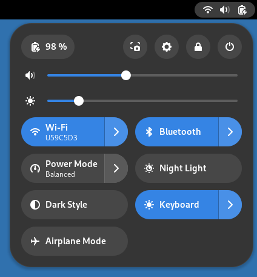
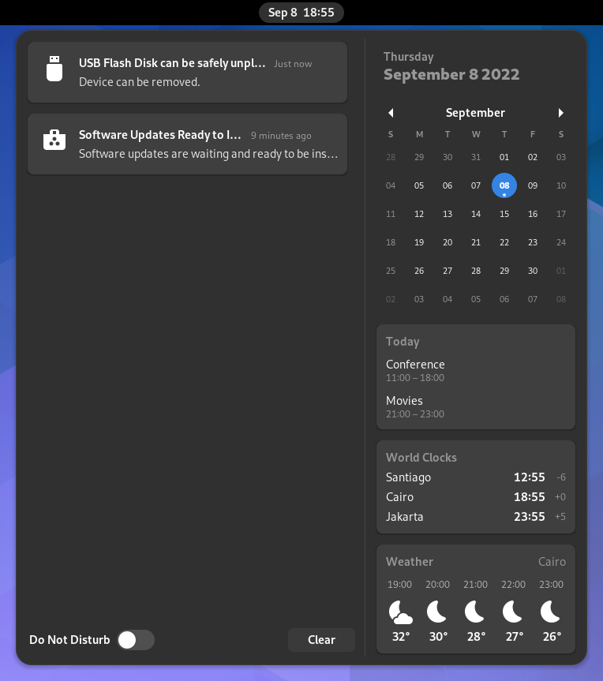

# Personnaliser les menus, réglages rapides, calendrier et notifications de GNOME Shell 51

Ce chapitre couvre les interfaces ouvertes depuis les indicateurs du panneau : menus contextuels, réglages rapides, menu date/heure et bannières de notification. Les sélecteurs ont été recoupés dans les sources GNOME Shell **51.0**. Ils sont des détails d'implémentation : ils peuvent changer dans une version ultérieure.





## Sources amont à conserver sous la main

- [Styles des menus et popovers](https://github.com/GNOME/gnome-shell/blob/51.0/data/theme/gnome-shell-sass/widgets/_popovers.scss)
- [Styles des réglages rapides](https://github.com/GNOME/gnome-shell/blob/51.0/data/theme/gnome-shell-sass/widgets/_quick-settings.scss)
- [Styles du calendrier et du menu date/heure](https://github.com/GNOME/gnome-shell/blob/51.0/data/theme/gnome-shell-sass/widgets/_calendar.scss)
- [Styles des notifications](https://github.com/GNOME/gnome-shell/blob/51.0/data/theme/gnome-shell-sass/widgets/_notifications.scss)
- [Création des menus du panneau](https://github.com/GNOME/gnome-shell/blob/51.0/js/ui/panelMenu.js)
- [Menu date et heure](https://github.com/GNOME/gnome-shell/blob/51.0/js/ui/dateMenu.js)
- [Gestion des notifications](https://github.com/GNOME/gnome-shell/blob/51.0/js/ui/messageTray.js)
- [Menu système](https://github.com/GNOME/gnome-shell/blob/51.0/js/ui/status/system.js)
- [Documentation St](https://gnome.pages.gitlab.gnome.org/gnome-shell/st/)

## 1. Comprendre la différence entre menu et popover

Dans le Shell, les menus du panneau sont des composants St pilotés par JavaScript. Le code crée le bouton, construit le menu, gère son ouverture, son ancrage, le focus et les raccourcis clavier. La feuille CSS ne fait que styliser les acteurs qui existent.

Dans `panelMenu.js`, le bouton de menu reçoit la classe `.panel-button`. Son menu reçoit `.panel-menu`. Ce dernier est ajouté à l'acteur du menu et son ouverture déclenche l'état pseudo-classe `:active` sur le bouton. Le menu est positionné par rapport au bouton d'origine et sa hauteur maximale tient compte de la zone de travail et du facteur d'échelle.

Ne confondez donc pas :
- le bouton dans le panneau ;
- le conteneur global du menu ;
- le contenu du menu ;
- les lignes et sous-menus ;
- les contrôles spécialisés intégrés à certains menus.

## 2. Menus contextuels : les sélecteurs principaux

Le SCSS `_popovers.scss` définit les familles suivantes :

- `.popup-menu-boxpointer` : conteneur avec pointe d'ancrage ;
- `.popup-menu` : acteur principal du menu ;
- `.popup-menu.panel-menu` : menu ouvert depuis le panneau ;
- `.popup-menu-content` : zone contenant les éléments ;
- `.popup-menu-item` : ligne interactive ;
- `.popup-ornamented-menu-item` : ligne avec ornement, coche ou raccourci ;
- `.popup-inactive-menu-item` : ligne non interactive ou informative ;
- `.popup-menu-arrow` et `.popup-menu-icon` : flèche et icône ;
- `.popup-sub-menu` : sous-menu ;
- `.popup-menu-ornament` : ornement de ligne ;
- `.popup-separator-menu-item` et `.popup-separator-menu-item-separator` : séparateur ;
- `.background-menu` : menu contextuel lié à l'arrière-plan ;
- `.app-menu` : menu d'application.

Exemple de personnalisation prudente :

```css
.popup-menu {
  border-radius: 16px;
}

.popup-menu-content {
  padding: 8px;
}

.popup-menu-item {
  min-height: 36px;
  border-radius: 8px;
  padding: 8px 12px;
}

.popup-menu-item:hover,
.popup-menu-item:focus {
  background-color: rgba(255, 255, 255, 0.10);
}

.popup-menu-item:active,
.popup-menu-item:checked {
  background-color: rgba(120, 174, 237, 0.24);
}

.popup-separator-menu-item-separator {
  background-color: rgba(255, 255, 255, 0.18);
}
```

Cet exemple est un point de départ : certaines lignes possèdent des enfants St et des ornements. Inspectez le résultat réel avant d'ajouter des sélecteurs descendants très spécifiques.

### États à toujours vérifier

Un menu doit être utilisable sans souris. Contrôlez :
- l'état normal ;
- le survol ;
- le focus clavier ;
- l'activation ;
- l'état coché ;
- l'état désactivé ;
- l'ouverture d'un sous-menu ;
- le sens de lecture gauche-droite et droite-gauche.

Le SCSS amont prévoit explicitement des ajustements `:ltr` et `:rtl` pour certains espacements. Ne remplacez pas ces règles par une marge gauche fixe : une interface française peut aussi être utilisée dans une session configurée en langue droite-à-gauche.

## 3. Réglages rapides : structure générale

Le panneau des réglages rapides possède le conteneur `.quick-settings` et une grille `.quick-settings-grid`. Les commandes activables utilisent `.quick-toggle`. Une commande avec une zone de menu supplémentaire utilise `.quick-toggle-has-menu`.

Les classes de présentation importantes comprennent :
- `.quick-toggle-title` : titre du réglage ;
- `.quick-toggle-subtitle` : état ou description secondaire ;
- `.quick-toggle-icon` : icône du réglage ;
- `.quick-toggle-menu-button` : bouton qui ouvre les options détaillées ;
- `.quick-toggle-separator` : séparation entre action principale et menu ;
- `.quick-toggle-menu` : carte de détail d'un réglage ;
- `.quick-slider` et `.slider-bin` : curseur et zone interactive ;
- `.quick-settings-system-item` : groupe de commandes système.

Exemple :

```css
.quick-toggle {
  border-radius: 999px;
}

.quick-toggle-title {
  font-weight: 700;
}

.quick-toggle-subtitle {
  opacity: 0.8;
}

.quick-toggle-icon {
  icon-size: 20px;
}

.quick-toggle-menu {
  border-radius: 18px;
}

.quick-slider .slider-bin:focus {
  outline: 2px solid #78aeed;
}
```

### Un bouton double n'est pas un seul bouton

Certains réglages associent deux actions : activer/désactiver rapidement une fonction et ouvrir son menu détaillé. Le Shell utilise `.quick-toggle-has-menu`, `.quick-toggle-menu-button` et `.quick-toggle-separator` pour les différencier.

Le CSS amont adapte les coins arrondis et les espacements selon `:ltr` et `:rtl`. Il gère également les états `:checked`, `:focus`, `:hover` et `:active`. Si vous personnalisez le fond actif, vérifiez que le bouton de menu secondaire reste distinct et que les deux zones sont encore faciles à identifier.

### Curseurs de luminosité et de volume

Les curseurs partagent la classe `.quick-slider`. Le conteneur interactif du curseur utilise `.slider-bin`. Les boutons d'icône peuvent utiliser `.icon-button`.

Ne réduisez pas la hauteur ou le padding du curseur pour gagner quelques pixels : la zone de saisie doit rester confortable. Contrôlez le focus clavier, le déplacement par flèches et l'affichage de la valeur minimale et maximale.

## 4. Le menu date et heure

Le menu date/heure est ouvert depuis l'horloge du panneau. Son conteneur utilise `.datemenu-popover` et sa zone calendrier `#calendarArea`. La colonne latérale porte `.datemenu-calendar-column`.

Les composants du calendrier incluent :
- `.datemenu-today-button`, `.day-label` et `.date-label` pour le résumé de la date ;
- `.calendar` pour le calendrier ;
- `.calendar-month-header` et `.calendar-month-label` pour le mois ;
- `.calendar-change-month-back` et `.calendar-change-month-forward` pour la navigation ;
- `.calendar-day` pour une date ;
- `.calendar-weekday`, `.calendar-weekend`, `.calendar-other-month`, `.calendar-today` et `.calendar-day-with-events` pour les états ;
- `.calendar-day-heading` pour les jours de la semaine ;
- `.calendar-week-number` pour le numéro de semaine.

Exemple :

```css
.datemenu-popover {
  border-radius: 20px;
}

.calendar {
  border-radius: 14px;
  padding: 8px;
}

.calendar .calendar-day {
  border-radius: 999px;
  min-width: 2.8em;
  min-height: 2.8em;
}

.calendar .calendar-day.calendar-today {
  font-weight: 700;
}

.calendar .calendar-day.calendar-other-month {
  opacity: 0.55;
}
```

Le jour courant et les jours qui possèdent des événements ont un traitement particulier dans le thème natif. Préservez une distinction compréhensible sans dépendre uniquement de la couleur. Les jours du mois précédent ou suivant doivent rester lisibles et ne pas ressembler à des dates désactivées si elles restent sélectionnables.

### Événements, horloges et météo

La colonne latérale peut présenter plusieurs widgets :
- `.events-button`, `.events-box`, `.events-title`, `.events-list`, `.event-box`, `.event-summary`, `.event-time` ;
- `.world-clocks-button`, `.world-clocks-header`, `.world-clocks-grid`, `.world-clocks-city`, `.world-clocks-time`, `.world-clocks-timezone` ;
- `.weather-button`, `.weather-box`, `.weather-header-box`, `.weather-header`, `.weather-grid`, `.weather-forecast-time`, `.weather-forecast-icon`, `.weather-forecast-temp`.

Exemple :

```css
.events-button,
.world-clocks-button,
.weather-button {
  border-radius: 14px;
  padding: 12px;
}

.event-summary,
.world-clocks-header,
.weather-header {
  font-weight: 700;
}

.event-time,
.world-clocks-timezone {
  opacity: 0.75;
}
```

La présence de ces blocs dépend des services, préférences et données disponibles. Une règle CSS ne crée ni événement, ni ville, ni emplacement météo. Pour tester correctement, configurez des horloges et des sources de calendrier dans la session.

## 5. Notifications

Les bannières de notification sont ciblées par `.notification-banner`. Le conteneur des actions est `.notification-buttons-bin` et les boutons utilisent `.notification-button`.

Exemple :

```css
.notification-banner {
  border-radius: 16px;
  padding: 12px;
}

.notification-buttons-bin {
  spacing: 8px;
}

.notification-button {
  border-radius: 10px;
  min-height: 36px;
}
```

Le contenu de la notification dépend de l'application et du service qui l'envoie. Le thème peut modifier l'apparence de la bannière et des actions, mais pas ajouter arbitrairement un bouton de réponse à toutes les notifications.

Ne rendez pas les notifications trop transparentes : elles doivent rester lisibles au-dessus d'un fond de bureau variable. Testez les notifications longues, les actions multiples, les notifications empilées, les notifications urgentes et les réglages « Ne pas déranger ».

## 6. Propriétés St et limites CSS

GNOME Shell utilise St, pas le moteur de mise en page d'un navigateur. Certaines propriétés telles que `spacing`, `icon-size`, `-st-icon-style`, `-natural-hpadding` et `-minimum-hpadding` appartiennent à St.

Les règles du Shell ne s'appliquent pas aux menus natifs GTK des applications. Un menu d'application GTK, un popover Libadwaita et un menu du panneau GNOME Shell sont trois systèmes différents.

## 7. Méthode de diagnostic

1. Ouvrez le menu à personnaliser et faites une capture de son état normal.
2. Vérifiez le fichier SCSS amont associé à la version exacte du Shell.
3. Ajoutez une seule règle avec une couleur très visible.
4. Rechargez le thème dans une session de test.
5. Vérifiez si le sélecteur cible le conteneur, la ligne ou l'icône.
6. Testez focus, hover, active, checked et insensitive.
7. Ouvrez tous les sous-menus et les menus longs.
8. Testez la session en clair, sombre et contraste élevé.
9. Testez une langue RTL si possible.
10. Retirez la règle de diagnostic et gardez uniquement le style final.

## 8. Exercices progressifs

### Exercice A — menu cohérent

Arrondissez le menu, augmentez légèrement le padding des lignes et ajoutez un fond de focus visible. Vérifiez les séparateurs et sous-menus.

### Exercice B — réglages rapides

Personnalisez les tuiles Wi-Fi et Bluetooth. Distinguez visuellement l'état actif et inactif sans masquer le titre ni le sous-titre.

### Exercice C — calendrier

Personnalisez le jour courant, les week-ends et les jours avec événements. Vérifiez que la navigation entre les mois reste évidente.

### Exercice D — notifications

Ajustez les coins, les marges et les boutons. Envoyez plusieurs notifications de test depuis différentes applications et vérifiez la lisibilité.

## 9. Checklist de validation

- Les menus sont accessibles au clavier.
- Le focus ne disparaît jamais sur un fond sombre ou clair.
- Les réglages actifs et inactifs sont différenciables.
- Les boutons doubles des quick toggles restent compréhensibles.
- Les curseurs gardent une zone interactive assez grande.
- Le jour courant et les événements sont identifiables autrement que par la seule couleur.
- Les notifications longues restent lisibles.
- Les sous-menus ne sortent pas de l'écran.
- Les styles fonctionnent en RTL et avec le contraste élevé.
- Aucun style de menu Shell n'est supposé s'appliquer aux menus GTK des applications.

## 10. Limites et maintenance

Les classes décrites ici correspondent à GNOME Shell 51.0. Une extension peut remplacer un menu ou ajouter des classes spécifiques. Les contenus et actions sont pilotés par le Shell et les services associés ; le thème ne doit pas les masquer ni prétendre les contrôler.

Avant de porter le thème vers une autre version de GNOME, comparez les fichiers SCSS et JavaScript amont et vérifiez chaque sélecteur dans l'interface réelle.


## 11. Préparer un environnement de validation

Les menus du panneau ne montrent pas toujours les mêmes contrôles. Leur contenu dépend des périphériques, des services, des préférences et des applications actives. Un menu réseau sur une machine portable avec Wi-Fi et VPN ne présente pas nécessairement les mêmes éléments qu'une machine fixe connectée en Ethernet.

Avant de modifier les styles, notez :
- version exacte de GNOME Shell ;
- session et distribution ;
- résolution et facteur d'échelle ;
- thème Shell chargé ;
- périphériques et services disponibles ;
- extensions qui ajoutent des indicateurs ;
- langue et sens de lecture ;
- état clair, sombre ou contraste élevé.

Préparez des états représentatifs : Wi-Fi connecté et déconnecté, Bluetooth activé et désactivé, volume faible et élevé, mode Ne pas déranger actif et inactif, alimentation secteur et batterie si disponibles. N'essayez pas de simuler un état de sécurité uniquement avec du CSS.

## 12. Tester les réglages rapides comme des contrôles interactifs

Une tuile de réglage rapide peut comporter une action principale et une action secondaire ouvrant un panneau détaillé. Il faut vérifier chaque zone séparément.

Pour chaque tuile :
1. Vérifiez son état initial et son libellé.
2. Survolez la zone principale.
3. Activez-la au clic.
4. Activez-la au clavier.
5. Vérifiez le changement de style de l'état actif.
6. Ouvrez le menu secondaire, s'il existe.
7. Revenez en arrière et vérifiez que le focus est cohérent.
8. Testez le contrôle quand la fonction est indisponible.

Sur les tuiles doubles, le séparateur ne doit pas disparaître au point de rendre les deux actions indiscernables. Ne faites pas porter le même style à la tuile entière et au bouton secondaire si cela rend leur fonction ambiguë.

### Réseau et Bluetooth

Testez le menu réseau avec les cas réellement disponibles :
- Wi-Fi activé et connecté ;
- Wi-Fi activé sans réseau ;
- Wi-Fi désactivé ;
- réseau filaire connecté ;
- VPN connecté et déconnecté si configuré ;
- liste de réseaux longue avec noms longs.

Pour Bluetooth, testez l'état activé, désactivé, la présence d'appareils connus et l'absence de périphérique détecté. Vérifiez que les noms longs ne débordent pas sur les contrôles d'action.

Ne masquez pas les libellés d'état et ne réduisez pas les icônes à un point de couleur : le contrôle doit rester compréhensible sans se fier uniquement à la couleur.

### Son et alimentation

Pour le son, contrôlez le curseur, son focus, les boutons de sortie et la liste des périphériques lorsqu'elle est disponible. La zone de saisie doit rester confortable et le niveau doit être identifiable.

Pour l'alimentation, testez sur batterie et sur secteur si le matériel le permet. Vérifiez les états faibles et les avertissements. Ne neutralisez jamais les couleurs ou indicateurs qui signalent un niveau critique.

## 13. Tester le calendrier et les événements

Le calendrier doit rester utilisable avec des configurations linguistiques et des données variées.

Testez :
- premier et dernier jour du mois ;
- mois qui commence en début et en fin de semaine ;
- dates du mois précédent et suivant affichées dans la grille ;
- changement de mois ;
- date du jour ;
- jours avec événements et sans événements ;
- événements avec titres longs ;
- plusieurs événements le même jour ;
- semaine contenant un changement d'année ;
- formats de date et de temps différents.

Vérifiez que le jour courant, le jour sélectionné et les jours avec événements ne sont pas identifiés par la même seule couleur. Le focus clavier doit rester distinct de la sélection. Les boutons de navigation du mois doivent garder une zone interactive suffisante.

La première journée de la semaine dépend de la locale. Ne supposez pas que le calendrier commence toujours le dimanche ou toujours le lundi. Testez au moins une locale différente de celle utilisée pour le développement si le thème vise plusieurs régions.

## 14. Tester horloges mondiales et météo

Les blocs d'horloges mondiales et de météo ne sont présents que si les services et préférences correspondants fournissent des données.

Pour les horloges :
- testez une ville avec un nom court et une autre avec un nom long ;
- vérifiez l'alignement de l'heure et du fuseau ;
- observez le passage entre deux dates ;
- vérifiez les heures proches du changement d'heure saisonnier.

Pour la météo :
- testez une description courte et une description longue ;
- vérifiez l'alignement de l'icône, de la température et du libellé ;
- contrôlez la lisibilité des prévisions multiples ;
- vérifiez le rendu sans données disponibles.

Ne créez pas de faux contenu météo ou de fausses heures dans le thème. Le CSS doit présenter correctement les données réelles et rester acceptable lorsque certains blocs ne sont pas disponibles.

## 15. Tester les notifications et leurs actions

Les notifications peuvent contenir un titre, un corps de texte, une icône, une image, une ou plusieurs actions et parfois des réponses. Le contenu dépend de l'application émettrice.

Préparez plusieurs notifications de test :
- titre court et corps court ;
- titre long et corps multiligne ;
- notification avec icône ;
- notification sans icône ;
- notification avec plusieurs actions ;
- notification avec réponse textuelle si l'application le permet ;
- notification répétée ou regroupée ;
- notification urgente ;
- notification pendant Ne pas déranger.

Vérifiez que :
- le texte ne passe pas sous les boutons ;
- les actions restent visibles et cliquables ;
- le focus clavier est visible ;
- les boutons ne deviennent pas trop petits ;
- la bannière reste lisible sur des fonds de bureau clairs et sombres ;
- les notifications empilées ne se recouvrent pas ;
- la fermeture ne masque pas une action.

Le thème ne doit pas supprimer les informations essentielles ni rendre une notification urgente visuellement identique à une notification ordinaire.

## 16. Contrôler le comportement des menus longs et des sous-menus

Les menus peuvent contenir plus d'éléments que l'espace vertical disponible. Vérifiez le comportement lorsque la liste est longue, lorsque plusieurs sections sont présentes et lorsque des sous-menus s'ouvrent près du bord de l'écran.

Testez :
- ouverture depuis chaque côté du panneau si la configuration le permet ;
- menu avec peu d'éléments ;
- menu avec beaucoup d'éléments ;
- sous-menu ouvert vers la gauche ou vers la droite ;
- navigation au clavier entre les lignes ;
- retour du sous-menu vers le menu parent ;
- fermeture par Échap ;
- fermeture après activation d'une commande.

Ne forcez pas une hauteur fixe sur tous les menus. Le Shell calcule leur position et leur taille en fonction de l'écran et du contenu. Une règle qui semble bonne sur un menu court peut couper un menu long.

## 17. Diagnostic : le menu ne correspond pas au sélecteur

Procédez méthodiquement :

1. Ouvrez le menu et identifiez son origine : panneau, calendrier, notification ou extension.
2. Vérifiez le conteneur principal et les enfants dans Looking Glass.
3. Relevez la classe exacte de la ligne ou du contrôle.
4. Vérifiez si l'acteur est construit par le Shell ou par une extension.
5. Ajoutez une règle de contour temporaire sur un seul niveau.
6. Vérifiez la règle gagnante et les propriétés St utilisées.
7. Testez les états normaux et interactifs.
8. Retirez les règles de diagnostic.

Un contrôle qui ressemble à un bouton peut être composé de plusieurs acteurs. Appliquer le fond au parent peut colorer toute la ligne, alors que le thème natif ne colore que l'icône ou la zone principale.

## 18. Diagnostic : une tuile est visuellement active mais la fonction est inactive

Le style ne doit pas être utilisé pour inventer un état. Si une tuile paraît activée alors que la fonction est désactivée, vérifiez d'abord le code et les classes d'état réellement appliquées par le Shell.

- Comparez l'état réel dans le système avec l'apparence.
- Vérifiez la pseudo-classe et les classes de l'acteur.
- Recherchez une règle trop générale qui applique le fond actif à toutes les tuiles.
- Vérifiez les sélecteurs de la zone principale et du bouton secondaire.
- Testez l'état indisponible ou désactivé.

Ne corrigez pas une incohérence fonctionnelle en changeant uniquement la couleur. Le style doit refléter l'état réel du contrôle.

## 19. Vérifier les langues et le sens de lecture

Les menus du Shell peuvent être affichés dans une langue avec des libellés plus longs ou un sens de lecture droite-à-gauche. Les marges fixes gauche/droite sont susceptibles de casser l'alignement.

Contrôlez :
- libellés traduits plus longs ;
- noms de périphériques longs ;
- textes avec accents et caractères non latins ;
- sens RTL ;
- icônes directionnelles ;
- sous-menus et flèches ;
- alignement des valeurs et des boutons secondaires.

Privilégiez les sélecteurs et propriétés directionnels pris en charge par le moteur plutôt que de supposer que la gauche est toujours le début de la ligne. Vérifiez les règles amont pour la version exacte du Shell.

## 20. Fiche de validation des menus et notifications

~~~text
GNOME Shell :
Distribution et session :
Résolution et échelle :
Langue et sens de lecture :
Thème Shell :
Extensions actives :
Menu testé :
État du périphérique ou du service :
États normaux et interactifs :
Navigation clavier :
Menus longs et sous-menus :
Libellés longs :
Notifications testées :
Actions de notification :
Mode Ne pas déranger :
Contraste et focus :
Anomalies :
Sélecteurs modifiés :
Conclusion : validé / partiel / à corriger
~~~

Validez séparément chaque famille de menus. Un menu réseau fonctionnel ne prouve pas que le calendrier ou les notifications sont correctement stylés : leurs acteurs, contenus et états sont différents.
