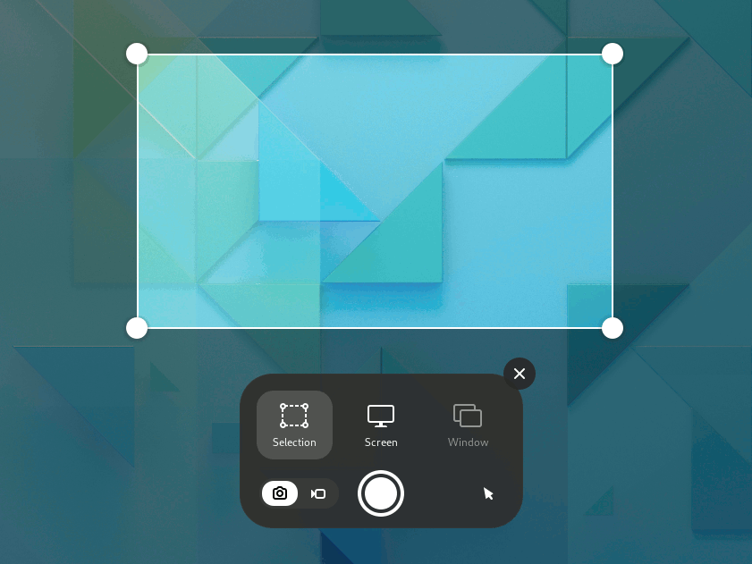

# OSD, dialogues système, sélecteurs de fenêtres et capture d'écran

Cette capture issue de GNOME User Documentation 51 sert de référence visuelle pour l’interface de capture ; les OSD et dialogues décrits plus loin sont d’autres composants.

Ce chapitre couvre les petites interfaces qui apparaissent au-dessus du bureau : indicateurs de volume et de luminosité, boîtes de dialogue, fenêtre d'exécution, sélecteur Alt-Tab et outil de capture. Elles sont parfois visibles quelques secondes seulement, mais elles font partie du thème GNOME Shell.

Les sélecteurs cités sont issus de l'inventaire GNOME Shell 51.0. Ils ne sont pas une API stable. Vérifiez toujours les sources de la version installée.

## 1. Comprendre les interfaces superposées

Une interface superposée n'est pas forcément une fenêtre GTK. Dans GNOME Shell, beaucoup de ces éléments sont des acteurs St/Clutter dessinés directement par le Shell. Leur style se trouve dans le thème Shell, pas dans le thème GTK de vos applications.

Les principaux groupes sont :

- les OSD qui confirment une action matérielle ou système ;
- les dialogues modaux qui demandent une décision ;
- les dialogues d'authentification et de permission ;
- le sélecteur de fenêtres Alt-Tab ;
- la fenêtre de commande Alt-F2 ;
- l'interface de capture d'écran et d'enregistrement.

Ne confondez pas ces interfaces avec les fenêtres natives des applications. Une règle GTK sur button ne modifie pas nécessairement un bouton St du Shell.

## 2. OSD : volume, luminosité et retours système

OSD signifie *On-Screen Display*. Le Shell affiche ces indicateurs lorsqu'une action système est déclenchée : changement de volume, luminosité, périphérique audio ou autre retour visuel.

Les sélecteurs principaux sont :

- .osd-window : conteneur de l'indicateur ;
- .level : niveau visuel, par exemple la progression du volume ;
- .osd-monitor-label : indication de l'écran concerné ;
- .osd-break-countdown-label : compte à rebours associé à certains rappels.

Exemple de style :

~~~css
.osd-window {
  border-radius: 18px;
  padding: 14px 20px;
  background-color: rgba(32, 32, 32, 0.94);
  color: #ffffff;
}

.osd-window .level {
  border-radius: 999px;
  min-height: 8px;
}

.osd-monitor-label {
  border-radius: 10px;
  padding: 6px 10px;
}
~~~

Ce code donne une direction visuelle. Il ne faut pas supposer que tous les OSD contiennent un curseur .level ou le même nombre d'enfants.

### Comment tester un OSD

- Utilisez les touches matérielles de volume.
- Modifiez la luminosité si l'écran et le pilote exposent ce réglage.
- Branchez ou débranchez un périphérique audio.
- Si vous avez plusieurs écrans, vérifiez l'indication du moniteur.
- Répétez le test avec un facteur d'échelle différent.

Ne masquez pas les OSD pour obtenir un bureau plus épuré : ils confirment à l'utilisateur qu'une action a été prise en compte.

## 3. Dialogues modaux

Un dialogue modal bloque temporairement les interactions avec le reste du Shell. Il peut demander une confirmation, signaler une erreur ou proposer une action système.

Les classes générales recensées dans le thème 51.0 sont :

- .modal-dialog : conteneur du dialogue ;
- .modal-dialog-content-box : zone de contenu ;
- .modal-dialog-button-box : groupe des actions ;
- .modal-dialog-button : bouton ;
- .dialog-list : liste d'éléments ;
- .dialog-list-title : titre de la liste ;
- .dialog-list-scrollview : zone défilante ;
- .dialog-list-box : conteneur des lignes ;
- .dialog-list-item : ligne individuelle ;
- .message-dialog-content : contenu d'un message ;
- .message-dialog-title : titre ;
- .message-dialog-description : description.

Exemple :

~~~css
.modal-dialog {
  border-radius: 18px;
  padding: 18px;
}

.modal-dialog-content-box {
  spacing: 12px;
}

.modal-dialog-button-box {
  spacing: 8px;
}

.modal-dialog-button {
  border-radius: 999px;
  padding: 8px 16px;
}

.modal-dialog-button:default {
  background-color: #3584e4;
  color: #ffffff;
}
~~~

Les dialogues ne sont pas tous identiques. Certains héritent de ces classes puis ajoutent leurs propres sélecteurs. Le style général doit rester compatible avec les variantes de confirmation, d'erreur, de batterie faible et de fin de session.

### États à contrôler

- bouton normal ;
- survol ;
- focus clavier ;
- activation ;
- bouton par défaut ;
- bouton désactivé ;
- texte long ;
- contenu défilant ;
- disposition droite-à-gauche.

Ne supprimez pas le focus visible. Ne donnez pas le même aspect à une action destructive et à une action de validation ordinaire.

## 4. Fin de session et avertissement batterie

Les dialogues de fermeture et de fin de session utilisent notamment :

- .end-session-dialog ;
- .end-session-dialog-battery-warning ;
- .message-dialog-content ;
- .message-dialog-title ;
- .message-dialog-description.

Ils peuvent proposer la fermeture de session, le redémarrage ou l'arrêt. Leur apparence doit clairement distinguer l'action principale, l'annulation et les avertissements.

Exemple prudent :

~~~css
.end-session-dialog {
  border-radius: 18px;
}

.end-session-dialog-battery-warning {
  color: #f9a825;
  font-weight: 700;
}
~~~

Un avertissement ne doit pas dépendre uniquement de sa couleur : le texte et l'icône doivent conserver leur sens.

## 5. Dialogue d'exécution Alt-F2

La fenêtre d'exécution permet de saisir une commande dans le Shell. Elle est associée à :

- .run-dialog : conteneur ;
- .run-dialog-entry : champ de saisie ;
- .run-dialog-description : aide ou description.

Exemple :

~~~css
.run-dialog {
  border-radius: 14px;
  padding: 12px;
}

.run-dialog-entry {
  border-radius: 10px;
  padding: 8px 12px;
}

.run-dialog-description {
  opacity: 0.8;
}
~~~

Pour tester l'apparence, ouvrez la fenêtre avec Alt-F2 puis fermez-la sans exécuter de commande. N'utilisez pas un thème en développement pour tester des commandes système inconnues.

## 6. Sélecteur de fenêtres Alt-Tab

Alt-Tab affiche un sélecteur de fenêtres ou d'applications selon les préférences et le contexte. Les éléments visuels repérés dans le thème Shell comprennent :

- .switcher-popup : surface générale ;
- .switcher-list : liste des choix ;
- .switcher-list-item-container : conteneur d'un choix ;
- .item-box : élément sélectionnable ;
- .thumbnail-box et .thumbnail : aperçu de fenêtre ;
- .switcher-arrow : indicateur de navigation ;
- .cycler-highlight : mise en évidence de la fenêtre ciblée.

Exemple :

~~~css
.switcher-popup {
  border-radius: 18px;
  padding: 12px;
}

.switcher-list {
  spacing: 8px;
}

.switcher-list .item-box {
  border: 1px solid rgba(255, 255, 255, 0.18);
  border-radius: 12px;
  padding: 8px;
}

.switcher-arrow {
  color: #ffffff;
}
~~~

La pseudo-classe exacte utilisée par le thème pour l'élément sélectionné doit être vérifiée dans le SCSS 51.0. L'exemple ci-dessus ne doit pas remplacer les états natifs sans inspection.

### Vérifications

- Plusieurs fenêtres d'une même application.
- Plusieurs applications.
- Navigation avec Tab et les flèches.
- Fenêtres avec des titres longs.
- Plusieurs écrans.
- Aperçus de fenêtres de tailles différentes.

Un aperçu ne doit pas être rogné de manière à masquer le contenu qui permet d'identifier la fenêtre.

## 7. Interface de capture d'écran

GNOME Shell possède une interface de capture intégrée. Elle permet de sélectionner une zone, une fenêtre ou un écran, de choisir certains paramètres et de lancer une capture ou un enregistrement.

Les sélecteurs recensés pour GNOME Shell 51.0 comprennent :

- .screenshot-ui-panel : panneau principal ;
- .screenshot-ui-close-button : fermeture ;
- .screenshot-ui-type-button : choix du type de capture ;
- .screenshot-ui-capture-button : action de capture ;
- .screenshot-ui-capture-button-circle : indicateur circulaire ;
- .screenshot-ui-shot-cast-container et .screenshot-ui-shot-cast-button : capture vidéo et diffusion ;
- .screenshot-ui-show-pointer-button : affichage du pointeur ;
- .screenshot-ui-area-selector : sélection de zone ;
- .screenshot-ui-area-indicator-shade : voile autour de la sélection ;
- .screenshot-ui-area-indicator-selection : rectangle sélectionné ;
- .screenshot-ui-area-selector-handle : poignées de sélection ;
- .screenshot-ui-window-selector et .screenshot-ui-window-selector-window : sélection de fenêtre ;
- .screenshot-ui-window-selector-window-border : contour de la fenêtre ;
- .screenshot-ui-window-selector-check : indication de sélection ;
- .screenshot-ui-screen-selector : sélection d'écran ;
- .screenshot-ui-tooltip : infobulle.

Exemple de personnalisation de la surface :

~~~css
.screenshot-ui-panel {
  border-radius: 18px;
  padding: 12px;
}

.screenshot-ui-type-button,
.screenshot-ui-close-button,
.screenshot-ui-show-pointer-button {
  border-radius: 999px;
}

.screenshot-ui-area-indicator-selection {
  border: 2px solid #78aeed;
}
~~~

L'interface de capture est un outil de travail. Préservez les indications de sélection, les poignées et le contraste entre la zone choisie et le voile extérieur. Les poignées doivent rester faciles à saisir.

### Test complet

1. Ouvrez l'outil avec le raccourci de capture d'écran de GNOME.
2. Sélectionnez une zone.
3. Déplacez et redimensionnez la sélection.
4. Basculez entre zone, fenêtre et écran.
5. Vérifiez le bouton de capture et le bouton de fermeture.
6. Testez l'option d'affichage du pointeur.
7. Vérifiez le comportement sur un écran HiDPI et avec plusieurs moniteurs.

## 8. OSD des tablettes graphiques

Certains environnements affichent un OSD de configuration de tablette graphique. Les classes repères sont :

- .pad-osd-window ;
- .pad-osd-title-box ;
- .combo-box-label.

Ces éléments ne sont visibles que si le matériel, le pilote et la configuration exposent cette interface. Il est inutile de conclure qu'un sélecteur est incorrect parce que l'élément n'apparaît pas sur un ordinateur sans tablette.

## 9. Méthode de diagnostic

Quand une règle ne semble pas agir :

1. Vérifiez que le composant appartient au Shell et non à une application GTK.
2. Vérifiez que le sélecteur est présent dans la version installée.
3. Ouvrez Looking Glass pour examiner l'acteur lorsqu'il est visible.
4. Inspectez les règles CSS chargées et les erreurs du Shell.
5. Désactivez temporairement les extensions qui remplacent l'interface concernée.
6. Retestez sans autre modification.

Les OSD sont éphémères : préparez le changement CSS avant de déclencher l'action. Pour les interfaces de capture et Alt-Tab, gardez un moyen de fermer l'interface même si le style est mauvais.

## 10. Exercices

### Exercice A — OSD

Modifiez le rayon du panneau et contrôlez les retours de volume et de luminosité.

### Exercice B — dialogue

Personnalisez les boutons d'un dialogue modal et vérifiez le focus, l'action par défaut et les états désactivés.

### Exercice C — Alt-Tab

Augmentez l'espacement entre les éléments sans masquer les aperçus. Testez avec plusieurs fenêtres.

### Exercice D — capture

Modifiez le contour de sélection et vérifiez que la zone choisie reste évidente sur des fonds clairs et sombres.

## 11. Sources amont GNOME Shell 51.0

- [OSD — osdWindow.js](https://gitlab.gnome.org/GNOME/gnome-shell/-/blob/51.0/js/ui/osdWindow.js)
- [Capture — screenshot.js](https://gitlab.gnome.org/GNOME/gnome-shell/-/blob/51.0/js/ui/screenshot.js)
- [Fenêtres — altTab.js](https://gitlab.gnome.org/GNOME/gnome-shell/-/blob/51.0/js/ui/altTab.js)
- [Dialogue d'exécution — runDialog.js](https://gitlab.gnome.org/GNOME/gnome-shell/-/blob/51.0/js/ui/runDialog.js)
- [Thème Shell — widgets SCSS](https://gitlab.gnome.org/GNOME/gnome-shell/-/tree/51.0/data/theme/gnome-shell-sass/widgets)
- [Documentation St](https://gnome.pages.gitlab.gnome.org/gnome-shell/st/)

## 12. Préparer des états reproductibles pour les OSD

Les OSD sont éphémères. Préparez la feuille CSS avant de déclencher l'action, puis consignez le matériel et le contexte : clavier, touches multimédia, pilote graphique, nombre d'écrans, facteur d'échelle et session.

Testez au moins :
- volume à zéro, faible, moyen et élevé ;
- volume coupé puis réactivé ;
- changement de périphérique de sortie ;
- luminosité faible, moyenne et élevée si elle est réglable ;
- branchement ou retrait d'un périphérique audio ;
- OSD affiché sur chaque écran lorsque plusieurs moniteurs sont utilisés.

Ne supposez pas qu'un OSD de luminosité sera présent sur un écran externe. Le matériel et le pilote déterminent si le réglage est exposé au Shell.

### Contrôler la géométrie et la lisibilité

Observez la position de l'OSD, son ancrage, sa largeur et sa hauteur. Vérifiez que le niveau reste lisible lorsque la valeur est minimale ou maximale et que le texte ne déborde pas avec une traduction longue.

Un OSD doit rester visible au-dessus des fenêtres et sur des fonds très différents. Une transparence excessive peut le rendre illisible sur une fenêtre claire. Une ombre trop forte peut au contraire produire un halo gênant.

Ne définissez pas une largeur fixe globale pour .osd-window sans vérifier les variantes de contenu. Le Shell peut utiliser ce conteneur pour des messages et des indicateurs qui n'ont pas la même structure.

## 13. Tester les dialogues modaux selon leur fonction

Les dialogues modaux ne sont pas un seul composant uniforme. Le contenu et les actions dépendent de l'opération demandée. Préparez plusieurs situations dans un environnement de test :
- dialogue de confirmation avec deux actions ;
- message d'erreur avec une seule action ;
- demande d'autorisation ;
- liste de périphériques ;
- avertissement de batterie ;
- dialogue de fin de session ;
- texte descriptif long ;
- contenu défilant.

Pour chaque dialogue, vérifiez :
1. Le titre est distinct du corps.
2. Le texte reste lisible et ne passe pas sous les boutons.
3. Les actions ont des libellés compréhensibles.
4. Le bouton par défaut est identifiable.
5. Le focus clavier est visible.
6. Échap ferme uniquement les dialogues pour lesquels cette action est prévue.
7. Les actions destructives ne ressemblent pas à une action neutre.
8. Le contenu reste accessible à une échelle élevée.

Ne forcez pas tous les dialogues à avoir la même largeur ou la même hauteur. Certains contiennent des listes, des avertissements ou des explications qui exigent davantage d'espace.

## 14. Vérifier Alt-Tab et Alt-Échap

Le sélecteur varie selon les préférences de regroupement, les espaces de travail et les fenêtres ouvertes. Il faut tester le parcours de sélection et non seulement la capture du popup.

Scénarios :
- plusieurs applications différentes ;
- plusieurs fenêtres de la même application ;
- fenêtres réparties sur plusieurs espaces de travail ;
- fenêtre maximisée et fenêtre de petite taille ;
- titres longs ;
- applications avec icône générique ;
- navigation maintenue avec Alt puis relâchement ;
- navigation inverse avec Maj ;
- Alt-Échap si le raccourci est configuré.

Pendant la navigation, le retour visuel doit suivre immédiatement l'élément sélectionné. Le contraste doit être suffisant pour distinguer l'élément actif des autres, même lorsque les miniatures ont des couleurs proches.

Vérifiez séparément les préférences qui changent le regroupement des fenêtres et des applications. Le nombre et l'ordre des éléments affichés ne sont pas contrôlés par le CSS.

### Contrôler les aperçus

Les miniatures peuvent représenter des fenêtres avec des proportions très différentes. Contrôlez les formats paysage, portrait et très petits, ainsi que les fenêtres contenant des zones très claires ou très sombres.

Évitez de réduire excessivement les miniatures pour gagner de la place. Si le popup devient trop large, examinez d'abord les espacements et les marges. Préservez une cible visuelle suffisamment grande pour identifier la sélection.

## 15. Vérifier la fenêtre Alt-F2 sans exécuter de commande

La fenêtre d'exécution est un champ de saisie fonctionnel. Son apparence ne doit pas rendre le texte saisi, le curseur ou les suggestions difficiles à distinguer.

Testez :
- champ vide ;
- saisie courte ;
- saisie longue ;
- texte avec accents ;
- correction et sélection de texte ;
- focus à l'ouverture ;
- fermeture par Échap ;
- affichage sur un écran à facteur d'échelle élevé.

Pour un test visuel, ouvrez Alt-F2, saisissez une chaîne inoffensive comme test-theme puis fermez le dialogue sans valider. N'exécutez pas de commande inconnue pour provoquer un résultat visuel.

## 16. Tester l'interface de capture étape par étape

L'outil de capture combine des contrôles et une zone de sélection. Testez les opérations dans l'ordre où elles sont réellement utilisées :

1. Ouvrez l'interface de capture.
2. Vérifiez les commandes de type de capture.
3. Sélectionnez une fenêtre et observez son contour.
4. Sélectionnez un écran et vérifiez l'indication de l'écran cible.
5. Sélectionnez une zone.
6. Déplacez la zone sélectionnée.
7. Redimensionnez-la avec chaque poignée.
8. Vérifiez le voile extérieur et le contour intérieur.
9. Activez ou désactivez l'affichage du pointeur.
10. Fermez l'outil sans enregistrer.

Si l'enregistrement vidéo est disponible, vérifiez également les états avant démarrage, pendant l'enregistrement et à l'arrêt. Ne masquez jamais un indicateur qui permet de savoir qu'une capture ou un enregistrement est actif.

### Problèmes fréquents de sélection

Si le contour ne correspond pas à la zone sélectionnée, inspectez séparément l'acteur de sélection, les poignées et le voile. Le CSS peut changer les bordures et les couleurs, mais ne corrige pas le calcul des coordonnées ou la zone réellement capturée.

Si les poignées sont difficiles à saisir, n'augmentez pas uniquement leur décoration. Vérifiez leur taille interactive réelle et les acteurs créés par le Shell. Une poignée visuellement plus grande ne signifie pas nécessairement que sa zone de capture des événements l'est aussi.

## 17. Valider les dialogues sur plusieurs écrans et échelles

Les dialogues sont généralement positionnés par le Shell dans un espace d'écran disponible. Une largeur confortable sur un écran 4K peut être disproportionnée sur un écran plus petit.

Testez :
- écran unique ;
- plusieurs écrans de tailles différentes ;
- écran principal à gauche puis à droite ;
- résolution réduite ;
- facteur d'échelle 100 %, 150 % et 200 % lorsque disponibles ;
- texte agrandi ;
- langue avec libellés longs ;
- sens de lecture RTL.

Contrôlez que le dialogue ne sort pas de l'écran, que ses boutons restent visibles et que le focus n'est pas masqué par une bordure ou une ombre.

## 18. Distinguer le défaut CSS du défaut fonctionnel

Le CSS ne pilote pas les raccourcis clavier, le choix de la fenêtre active, la capture réelle, le volume ni les permissions.

Quand le résultat est incorrect :
- vérifiez d'abord si l'action système fonctionne sans le thème personnalisé ;
- observez si le composant est créé et si son état évolue ;
- inspectez les classes et les acteurs dans Looking Glass ;
- vérifiez ensuite la cascade et les propriétés CSS ;
- comparez avec le thème GNOME natif.

Exemples :
- un OSD absent après une touche de volume peut relever du périphérique ou du service audio ;
- Alt-Tab qui choisit la mauvaise fenêtre relève de la logique de sélection ;
- une capture qui contient la mauvaise zone relève du calcul de capture ;
- un bouton modal inactif relève de l'action ou du dialogue, pas de son apparence.

Ne tentez pas de corriger ces problèmes en augmentant la spécificité CSS.

## 19. Accessibilité des interfaces temporaires

Les interfaces temporaires sont souvent utilisées rapidement. Préservez :
- le contraste du texte et des icônes ;
- la distinction entre sélection et survol ;
- le focus visible ;
- des boutons assez grands ;
- des libellés compréhensibles ;
- la visibilité des avertissements ;
- des indications qui ne reposent pas uniquement sur la couleur.

Vérifiez que les transitions n'empêchent pas de comprendre l'état courant. Une animation décorative ne doit pas retarder l'affichage de l'information utile ni masquer un indicateur de sécurité.

## 20. Fiche de validation OSD et dialogues

~~~text
GNOME Shell et version :
Session :
Résolution et facteur d'échelle :
Nombre et disposition des écrans :
Langue et sens de lecture :
OSD testés :
Matériel et périphériques :
Dialogues testés :
Alt-Tab / Alt-Échap :
Alt-F2 :
Interface de capture :
États clavier et focus :
Échelle élevée :
Textes longs :
Indicateurs de sécurité préservés :
Extensions actives :
Sélecteurs modifiés :
Captures ou vidéos :
Anomalies :
Conclusion : validé / partiel / à corriger
~~~

Une validation complète doit couvrir les transitions et les actions réelles. Une capture isolée ne prouve ni que le focus est visible, ni que le dialogue fonctionne, ni que la sélection de capture correspond à la zone dessinée.
