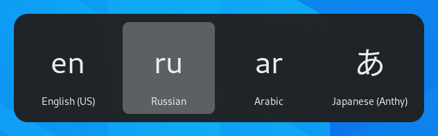

# Clavier virtuel, saisie, IBus et accessibilité du Shell

Cette capture officielle montre le changement de méthode de saisie. Elle ne représente pas tous les panneaux de clavier virtuel ni toutes les interfaces IBus.

Ce chapitre couvre les éléments du Shell liés à la saisie et à l'accessibilité : clavier à l'écran, suggestions, panneaux de caractères, méthodes de saisie et aides visuelles. Ces interfaces ne sont pas toujours visibles. Leur présence dépend de la langue, du matériel, des méthodes de saisie configurées et des options d'accessibilité activées.

Les sélecteurs sont ceux de l'inventaire GNOME Shell 51.0. Ils peuvent changer : vérifiez la version installée avant de les réutiliser.

## 1. Clavier virtuel

Le clavier à l'écran est une interface du Shell, pas un clavier GTK ordinaire. Les principaux sélecteurs recensés sont :

- #keyboard : conteneur du clavier ;
- .key-container : conteneur d'une touche ;
- .keyboard-key : touche ;
- .default-key : touche ayant un rôle particulier ;
- .keyboard-subkeys-boxpointer : panneau des variantes affichées lors d'un appui prolongé ;
- .emoji-page et .emoji-panel : zone de sélection des emoji ;
- .word-suggestions : suggestions de mots.

Exemple :

~~~css
#keyboard {
  spacing: 6px;
}

#keyboard .keyboard-key {
  border-radius: 8px;
  padding: 8px;
  min-height: 42px;
}

#keyboard .keyboard-key:active {
  background-color: #3584e4;
  color: #ffffff;
}

.keyboard-subkeys-boxpointer {
  border-radius: 12px;
  padding: 8px;
}

.word-suggestions {
  spacing: 10px;
}
~~~

Les dimensions sont des valeurs de départ. Le clavier doit rester utilisable sur un écran tactile : ne réduisez pas les touches pour gagner de la place. Vérifiez les variantes d'une touche, les touches spéciales, les caractères accentués et les dispositions linguistiques.

### Vérifications

- Activez le clavier à l'écran dans les paramètres d'accessibilité.
- Essayez une disposition française et une autre disposition.
- Testez les touches avec variantes et les appuis prolongés.
- Vérifiez le panneau emoji et les suggestions.
- Testez avec un facteur d'échelle différent.

## 2. Champs Shell et états de saisie

Les champs du Shell peuvent être construits avec StEntry. Les classes et repères transversaux comprennent :

- StEntry : champ de saisie St ;
- .capslock-warning : avertissement de verrouillage majuscule ;
- .peek-password : contrôle d'affichage du mot de passe ;
- .hint-text : texte d'aide ou d'indication.

Exemple :

~~~css
StEntry {
  border-radius: 9px;
  padding: 8px 10px;
}

StEntry:focus {
  border-color: #78aeed;
}

.capslock-warning {
  color: #f9a825;
  font-weight: 700;
}

.hint-text {
  opacity: 0.8;
}
~~~

Les noms de pseudo-classes et les propriétés prises en charge dépendent du widget St et de son thème. N'appliquez pas automatiquement la syntaxe CSS d'un navigateur. Le champ doit conserver un focus visible et un contraste suffisant.

Ne masquez jamais un avertissement de verrouillage majuscule ou un contrôle d'affichage de mot de passe pour des raisons purement esthétiques.

## 3. Méthodes de saisie IBus

IBus permet d'utiliser des méthodes de saisie qui ne correspondent pas directement à une touche physique : composition de caractères, saisie de langues asiatiques, choix de candidats et navigation entre pages.

Les sélecteurs repérés dans GNOME Shell 51.0 comprennent :

- .candidate-popup-boxpointer : conteneur du popup de candidats ;
- .candidate-popup-content : contenu du popup ;
- .candidate-index : index d'un candidat ;
- .candidate-box : candidat ;
- .candidate-page-button : bouton de pagination ;
- .candidate-page-button-previous et .candidate-page-button-next : navigation précédente et suivante.

Exemple :

~~~css
.candidate-popup-boxpointer {
  border-radius: 12px;
  padding: 8px;
}

.candidate-popup-content {
  spacing: 6px;
}

.candidate-box {
  border-radius: 8px;
  padding: 6px 10px;
}

.candidate-box:selected,
.candidate-box:focus {
  background-color: #3584e4;
  color: #ffffff;
}

.candidate-index {
  opacity: 0.75;
}

.candidate-page-button {
  border-radius: 8px;
  padding: 6px;
}
~~~

Vérifiez les états réellement employés par la version installée avant de conserver les pseudo-classes de l'exemple. Un candidat sélectionné doit rester identifiable sans dépendre uniquement de la couleur.

### Test IBus

1. Configurez une méthode de saisie supplémentaire dans les paramètres.
2. Activez cette méthode depuis le sélecteur de langue du panneau.
3. Ouvrez un champ de texte dans une application.
4. Saisissez une séquence qui ouvre le panneau de candidats.
5. Parcourez les candidats et les pages avec le clavier.
6. Vérifiez que le popup ne sort pas de l'écran et reste lisible.

Une session sans méthode de saisie supplémentaire ne permet pas de valider cette partie du thème.

## 4. Aides visuelles d'accessibilité

Le Shell fournit plusieurs éléments d'aide visuelle :

- .ripple-pointer-location : indication visuelle de l'emplacement du pointeur ;
- .pie-timer : minuteur visuel ;
- .magnifier-zoom-region : région de zoom de la loupe ;
- .select-area-rubberband : rectangle de sélection d'une zone.

Exemple :

~~~css
.ripple-pointer-location {
  border: 2px solid #ffffff;
  background-color: rgba(53, 132, 228, 0.35);
}

.pie-timer {
  color: #ffffff;
}

.select-area-rubberband {
  border: 2px solid #3584e4;
  background-color: rgba(53, 132, 228, 0.12);
}
~~~

La loupe peut afficher une zone agrandie et modifier la perception des couleurs et des contours. Testez son rendu sur plusieurs arrière-plans et ne réduisez pas sa visibilité.

## 5. Ce que le CSS ne peut pas corriger

Le thème ne remplace pas l'arbre d'accessibilité d'une application. Les rôles, noms accessibles, descriptions, ordre de lecture et annonces vocales sont fournis par les widgets, les applications et AT-SPI.

Le CSS ne peut pas :

- donner un nom accessible à un bouton qui n'en possède pas ;
- corriger l'ordre de lecture d'un lecteur d'écran ;
- rendre accessible au clavier une action qui ne reçoit aucun événement clavier ;
- transformer un texte intégré dans une image en texte sélectionnable ;
- corriger une annonce vocale manquante.

Quand un problème relève de ces comportements, il faut corriger le composant ou l'application, pas ajouter une règle CSS.

## 6. Contraste, focus et réduction des animations

Pour chaque composant de saisie, prévoyez les états suivants :

- repos ;
- survol ;
- focus clavier ;
- activation ;
- sélection ;
- indisponibilité ;
- erreur ;
- avertissement ;
- chargement.

Le focus doit rester visible. Les messages d'erreur et d'avertissement doivent associer une couleur à un libellé ou un symbole. Ne réduisez pas l'opacité au point de rendre un texte secondaire illisible.

Respectez les préférences GNOME de contraste élevé et de réduction des animations. Ne supposez pas que la propriété CSS du navigateur prefers-reduced-motion est prise en charge par St. Les mécanismes de préférence sont différents selon le moteur.

## 7. Langues, direction et caractères

Testez le thème dans au moins deux contextes linguistiques :

- français ou anglais, de gauche à droite ;
- une langue de droite à gauche, si elle fait partie des usages ciblés.

Vérifiez les marges logiques, l'ordre des boutons, les flèches directionnelles, les textes longs, les chiffres, les accents et les glyphes. Ne retournez pas les icônes non directionnelles.

Le clavier virtuel et IBus doivent être testés avec les méthodes de saisie réellement configurées. Un thème qui fonctionne uniquement avec une disposition française n'est pas un thème internationalisé.

## 8. Exercices

### Exercice A — clavier virtuel

Augmentez le rayon des touches et vérifiez leur taille tactile, les touches spéciales et les variantes.

### Exercice B — IBus

Modifiez le style d'un candidat et vérifiez la sélection, la pagination et la navigation clavier.

### Exercice C — focus

Vérifiez que le focus est visible dans les champs Shell, les candidats et les touches du clavier virtuel.

### Exercice D — contraste élevé

Activez le contraste élevé et vérifiez que les textes, icônes et contours restent identifiables.

## 9. Sources amont GNOME Shell 51.0

- [Clavier virtuel — keyboard.js](https://gitlab.gnome.org/GNOME/gnome-shell/-/blob/51.0/js/ui/keyboard.js)
- [Méthodes de saisie — ibusCandidatePopup.js](https://gitlab.gnome.org/GNOME/gnome-shell/-/blob/51.0/js/ui/ibusCandidatePopup.js)
- [Thème Shell — widgets SCSS](https://gitlab.gnome.org/GNOME/gnome-shell/-/tree/51.0/data/theme/gnome-shell-sass/widgets)
- [Accessibilité GNOME](https://help.gnome.org/users/gnome-help/stable/a11y.html)
- [Documentation St](https://gnome.pages.gitlab.gnome.org/gnome-shell/st/)

## 10. Organiser une validation clavier complète

Un test visuel à la souris ne suffit pas pour les composants de saisie. Préparez une session de test distincte et notez les options d'accessibilité activées, la disposition clavier, les méthodes IBus et la langue de l'interface.

Parcourez les interfaces sans souris :
1. Ouvrez les réglages rapides et atteignez le sélecteur de méthode de saisie.
2. Changez de méthode de saisie.
3. Ouvrez un champ de texte.
4. Déplacez le curseur, sélectionnez du texte et utilisez les touches de correction.
5. Ouvrez le clavier virtuel si cette fonction est activée.
6. Parcourez les touches avec les mécanismes clavier disponibles.
7. Ouvrez les variantes d'une touche et choisissez-en une.
8. Déclenchez les suggestions et parcourez-les.
9. Fermez les panneaux avec le clavier.
10. Vérifiez que le focus revient au composant attendu.

Le focus visuel doit suivre le focus fonctionnel. Si le focus change sans que le style change, inspectez l'état du widget et la pseudo-classe réellement appliquée avant de modifier le CSS.

## 11. Vérifier les dispositions et les compositions de caractères

Testez plus d'une disposition. Une disposition française AZERTY, une disposition anglaise QWERTY et une méthode de composition ne sollicitent pas les mêmes touches ni les mêmes libellés.

Vérifiez :
- touches alphabétiques et numériques ;
- touches mortes et caractères accentués ;
- AltGr et combinaisons ;
- changement de casse ;
- verrouillage majuscule ;
- ponctuation et symboles ;
- touches de navigation et de correction ;
- variantes accessibles par appui prolongé ;
- caractères non latins si la langue cible les utilise.

Le clavier virtuel doit représenter la disposition active et non une image décorative figée. Si la légende d'une touche ne correspond pas au caractère saisi, recherchez d'abord un problème de disposition ou de méthode de saisie.

## 12. Tester les suggestions et les variantes

Les suggestions sont dynamiques et leur contenu dépend de la langue, du texte saisi et du service qui les fournit.

Préparez des cas :
- aucun texte saisi ;
- mot court ;
- mot avec accent ;
- mot long ;
- correction proposée ;
- plusieurs suggestions ;
- aucune suggestion ;
- saisie dans une langue avec alphabet différent.

Vérifiez que les suggestions ne se chevauchent pas avec le clavier, restent visibles à l'échelle élevée et peuvent être parcourues sans ambiguïté. Ne supposez pas que le contenu ou le nombre de suggestions sera constant d'une session à l'autre.

Pour les variantes de touches, testez un appui prolongé sur plusieurs touches qui proposent des caractères alternatifs. Vérifiez le positionnement du panneau, sa fermeture après sélection et le contraste du caractère choisi.

## 13. Configurer et tester IBus de manière contrôlée

IBus doit être configuré dans la session de test. Les noms et les étapes d'installation d'une méthode de saisie dépendent de la distribution et des paquets disponibles.

Procédure générale :
1. Ouvrez les paramètres Clavier.
2. Ajoutez une source de saisie ou une méthode IBus prise en charge.
3. Vérifiez qu'elle apparaît dans le sélecteur du panneau.
4. Basculez vers cette méthode.
5. Ouvrez une application de texte.
6. Saisissez une séquence qui affiche les candidats.
7. Parcourez les candidats et les pages au clavier.
8. Validez un candidat.
9. Revenez à la méthode précédente.
10. Vérifiez que le texte final et le focus du champ sont corrects.

Si le popup n'apparaît pas, vérifiez d'abord que la méthode IBus est active et que la séquence saisie déclenche effectivement une composition. Le thème ne peut pas faire apparaître un candidat que le moteur de saisie ne fournit pas.

### États du popup de candidats

Contrôlez les états suivants :
- candidat normal ;
- candidat sélectionné ;
- candidat survolé ;
- candidat ciblé au clavier ;
- index du candidat ;
- pagination précédente et suivante ;
- liste longue ;
- libellé ou caractère non latin ;
- popup près du bord de l'écran.

Ne réduisez pas la taille du texte ou des cellules au point de rendre les candidats difficiles à distinguer. Les index sont utiles à la sélection rapide et doivent rester lisibles.

## 14. Vérifier les technologies d'assistance

Les styles visuels ne garantissent pas l'accessibilité sémantique. Utilisez les outils d'accessibilité disponibles dans la distribution pour vérifier l'arbre exposé par l'application ou le Shell.

Questions à contrôler :
- le composant a-t-il un rôle accessible cohérent ?
- son nom accessible décrit-il sa fonction ?
- son état sélectionné ou désactivé est-il exposé ?
- les changements de suggestions sont-ils annoncés ?
- l'ordre de parcours est-il logique ?
- le focus clavier correspond-il à l'élément annoncé ?
- le texte d'aide est-il associé au champ ?

Orca permet de tester l'expérience avec un lecteur d'écran. Activez-le dans une session de test et parcourez les composants concernés. N'essayez pas de déduire les annonces vocales à partir de la seule apparence.

Si un contrôle n'est pas annoncé ou possède un nom incorrect, identifiez le composant qui construit son arbre accessible. Une règle CSS ne peut pas ajouter un nom accessible ou corriger le rôle exposé par AT-SPI.

## 15. Contraste élevé, grossissement et taille du texte

Testez les réglages d'accessibilité réels de GNOME plutôt que d'ajouter une classe CSS fictive.

Scénarios :
- contraste élevé activé ;
- texte agrandi ;
- zoom de la loupe ;
- pointeur agrandi ;
- indicateur de position du pointeur ;
- clavier virtuel actif ;
- affichage avec résolution réduite.

Vérifiez que les contours de focus restent visibles, que les touches restent assez grandes et que les panneaux ne sont pas coupés. Les textes longs ne doivent pas recouvrir les boutons de navigation ou de fermeture.

La loupe agrandit une région de l'écran ; elle peut donc révéler des défauts d'alignement ou de contraste invisibles à taille normale. Inspectez les bordures et les glyphes à fort grossissement.

## 16. Tester les animations et les transitions

Les transitions du clavier virtuel, des panneaux IBus et des suggestions doivent rester lisibles et ne pas retarder l'interaction.

Comparez le comportement avec les préférences d'animation disponibles dans GNOME. Ne transposez pas automatiquement la media query web prefers-reduced-motion dans St : vérifiez le mécanisme pris en charge par le Shell et la version ciblée.

Une animation doit accompagner l'ouverture ou la fermeture d'un panneau, pas cacher son état ni ralentir la sélection d'un candidat. Si le mouvement gêne l'utilisation, identifiez si le réglage relève du Shell, de l'extension ou du composant.

## 17. Diagnostic des problèmes de saisie

### Le clavier virtuel ne s'affiche pas

Vérifiez que la fonction est activée dans les paramètres d'accessibilité, que la session prend en charge le clavier à l'écran et que le Shell crée effectivement l'acteur. Une règle CSS ne peut pas activer cette fonction.

### Les touches affichent les mauvais caractères

Vérifiez la disposition active, la méthode de saisie, les touches mortes et la configuration de la langue. Ne corrigez pas les libellés par des pseudo-éléments CSS : cela masquerait la discordance entre affichage et saisie réelle.

### Le popup IBus est absent

Vérifiez que la méthode est active, que le moteur reçoit la séquence de composition et qu'une liste de candidats est produite. Consultez les journaux de session si nécessaire. Ne concluez pas à un défaut CSS avant d'avoir observé un popup natif.

### Le focus est difficile à voir

Inspectez le nœud réellement focalisé, son état St et la cascade. Vérifiez que la règle ne cible pas uniquement le survol. Testez avec le clavier, pas seulement avec le pointeur.

### Orca n'annonce pas le contrôle

Vérifiez le nom, le rôle, l'état et l'arbre d'accessibilité exposés. Le CSS ne corrige pas ces informations. Signalez le défaut dans le composant ou l'application concernée.

## 18. Fiche de validation saisie et accessibilité

~~~text
Version GNOME Shell :
Distribution et session :
Langue de l'interface :
Disposition clavier :
Méthodes IBus configurées :
Clavier virtuel :
Suggestions testées :
Variantes de touches :
Caractères accentués :
Caractères non latins :
Navigation clavier :
Focus visible :
Lecteur d'écran :
Rôles et noms accessibles :
Contraste élevé :
Texte agrandi et loupe :
Pointeur agrandi :
Animations :
Résolution et facteur d'échelle :
Extensions actives :
Sélecteurs modifiés :
Anomalies :
Conclusion : validé / partiel / à corriger
~~~

Une validation complète associe une vérification visuelle, une navigation clavier réelle et un contrôle de l'arbre accessible. Ne déclarez pas une interface accessible uniquement parce que ses couleurs et ses contours semblent lisibles.
