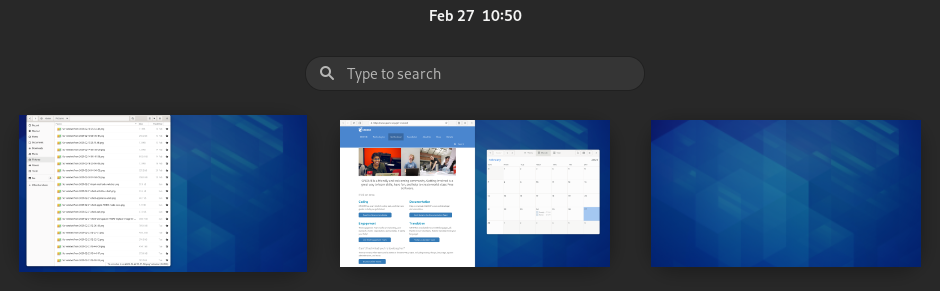

# Composants Shell spécialisés : espaces, avatars, défilement et dialogues avancés



Les chapitres précédents couvrent les grandes zones de GNOME Shell. Il reste des composants plus spécialisés, visibles seulement dans certaines situations : sélecteur d'espace de travail, fenêtre de redimensionnement, dialogues de permission, sélection audio, avatars, liens et aides visuelles.

Ce chapitre complète l'inventaire GNOME Shell 51.0. Il s'appuie sur les sélecteurs présents dans le catalogue et évite d'inventer des classes pour les modules dont les noms internes doivent être inspectés dans la source.

## 1. Sélecteur d'espace de travail

Le sélecteur d'espace de travail peut apparaître lors de raccourcis ou de gestes de navigation. Les repères CSS recensés sont :

- .workspace-switcher : conteneur ;
- .ws-switcher-indicator : indicateur de l'espace sélectionné.

Exemple :

~~~css
.workspace-switcher {
  border-radius: 14px;
  padding: 8px;
}

.ws-switcher-indicator {
  border: 2px solid #78aeed;
  border-radius: 8px;
}
~~~

Testez avec un, deux puis plusieurs espaces de travail. Vérifiez la sélection clavier, les animations et la visibilité de l'indicateur sur les fonds clair et sombre.

Ne confondez pas ce sélecteur temporaire avec la colonne des miniatures de la vue Activités.

## 2. Popup de redimensionnement

Le Shell peut afficher une fenêtre temporaire lors de certaines opérations de redimensionnement. Le sélecteur recensé est .resize-popup.

~~~css
.resize-popup {
  border-radius: 10px;
  padding: 8px 12px;
  background-color: rgba(32, 32, 32, 0.94);
  color: #ffffff;
}
~~~

La présence de ce popup dépend de la méthode de redimensionnement et du gestionnaire de fenêtres. Testez les opérations avec le clavier et la souris. Ne masquez pas les dimensions ou indications utiles à l'utilisateur.

## 3. Avatars et icônes utilisateur

Le Shell utilise plusieurs éléments visuels pour représenter un compte ou un utilisateur :

- .user-icon ;
- .user-avatar ;
- .user-widget ;
- .framed-user-icon dans les interfaces qui utilisent un avatar encadré.

Exemple de règle prudente :

~~~css
.user-avatar,
.user-icon {
  border-radius: 999px;
}
~~~

Le style ne doit pas déformer les images. Vérifiez les avatars carrés, les images manquantes, les comptes sans photo et les variantes de taille.

Les interfaces de connexion et de déverrouillage peuvent utiliser d'autres classes spécifiques : ne supposez pas qu'une règle sur .user-avatar couvre toutes les vues.

## 4. Liens Shell

La classe .shell-link identifie des liens dans certaines interfaces du Shell.

~~~css
.shell-link {
  color: #78aeed;
  text-decoration: underline;
}

.shell-link:focus {
  outline: 2px solid #78aeed;
  outline-offset: 2px;
}
~~~

Un lien doit être reconnaissable sans survol. Vérifiez sa lisibilité sur les fonds de dialogue, dans les messages et en navigation clavier.

## 5. Icônes basse résolution et ombres

Le thème Shell contient des classes transversales pour certains traitements d'icônes :

- .lowres-icon ;
- .icon-dropshadow.

Elles peuvent servir à distinguer ou améliorer la lisibilité d'icônes selon le contexte. Ne supprimez pas systématiquement les ombres : elles peuvent assurer le contraste sur un fond variable.

Exemple :

~~~css
.icon-dropshadow {
  icon-shadow: 0 1px 3px rgba(0, 0, 0, 0.35);
}
~~~

La propriété icon-shadow est spécifique à St. Elle n'est pas une propriété CSS standard du navigateur.

## 6. Défilement St

Les interfaces Shell utilisent StScrollView et StScrollBar. Les repères de style incluent StScrollBar, .vhandle et .hhandle.

~~~css
StScrollBar {
  -bar-width: 8px;
}

StScrollBar .vhandle,
StScrollBar .hhandle {
  background-color: rgba(255, 255, 255, 0.45);
  border-radius: 999px;
}
~~~

Les propriétés St et les nœuds disponibles doivent être vérifiés dans la version installée. Les barres de défilement peuvent être verticales ou horizontales et leur poignée peut apparaître seulement au survol.

Ne réduisez pas la zone interactive au point de rendre le défilement difficile. Testez au clavier, à la souris et avec un écran tactile.

## 7. Dialogues de permission et d'accès

Les dialogues de permission ne sont pas de simples messages. Ils peuvent demander une authentification ou l'autorisation d'accéder à une ressource.

Les classes recensées dans GNOME Shell 51.0 comprennent :

- .prompt-dialog ;
- .prompt-dialog-password-grid ;
- .prompt-dialog-password-entry ;
- .prompt-dialog-error-label ;
- .prompt-dialog-info-label ;
- .polkit-dialog-user-layout ;
- .polkit-dialog-user-label ;
- .polkit-dialog-user-root-label ;
- .access-dialog.

Exemple :

~~~css
.prompt-dialog-password-entry {
  border-radius: 8px;
  padding: 8px 10px;
}

.prompt-dialog-error-label {
  color: #c01c28;
  font-weight: 700;
}

.prompt-dialog-info-label {
  opacity: 0.85;
}
~~~

Ne masquez jamais une erreur d'authentification, un nom d'utilisateur ou une indication de permission. Vérifiez le contraste et la navigation clavier.

## 8. Sélection d'un périphérique audio

Le dialogue de sélection audio peut apparaître lorsque le système propose plusieurs périphériques de sortie ou d'entrée.

Les classes recensées sont :

- .audio-device-selection-dialog ;
- .audio-selection-box ;
- .audio-selection-device ;
- .audio-selection-device-box ;
- .audio-selection-device-icon.

Exemple :

~~~css
.audio-device-selection-dialog {
  border-radius: 16px;
}

.audio-selection-device {
  border-radius: 10px;
  padding: 8px;
}

.audio-selection-device:focus {
  outline: 2px solid #78aeed;
}
~~~

Testez avec plusieurs périphériques, un périphérique débranché et un nom long. L'utilisateur doit comprendre quel périphérique est sélectionné.

## 9. Contrôle parental, sessions et redémarrage

D'autres interfaces spécialisées peuvent apparaître selon les services installés et la configuration de la session :

- .parental-controls-shield, .parental-controls-shield-title, .parental-controls-shield-description et .parental-controls-shield-button ;
- .conflicting-session-dialog-content, .conflicting-session-dialog-title et .conflicting-session-dialog-desc ;
- .restart-message ;
- .welcome-dialog-image.

Ces interfaces ne sont pas présentes dans toutes les sessions. Un sélecteur sans effet peut simplement correspondre à une fonction non activée.

Ne supprimez pas les messages de contrôle parental, de conflit de session ou de redémarrage. Ils expliquent un état système ou une action requise.

## 10. QR codes et retours visuels

Le thème GNOME Shell 51 contient des modules dédiés aux QR codes et aux retours visuels de clic, notamment _qr-code.scss et _corner-ripple.scss.

Le nom du fichier SCSS ne suffit pas à déduire le nom des nœuds CSS. Pour personnaliser ces composants :

1. ouvrez le fichier SCSS de la version 51.0 ;
2. relevez les sélecteurs réellement définis ;
3. recherchez dans le code JavaScript où ils sont ajoutés ;
4. vérifiez dans Looking Glass qu'ils existent dans le contexte testé ;
5. écrivez une règle ciblée et testez-la.

Ne créez pas un sélecteur supposé comme .qr-code si le fichier amont ne le déclare pas. Cette règle évite de documenter un nom qui ne correspond à aucun acteur.

## 11. Exercices

### Exercice A — workspace switcher

Modifiez le contour de l'indicateur et vérifiez plusieurs espaces de travail.

### Exercice B — avatar

Ajustez le rayon d'un avatar et testez une image manquante et une image non carrée.

### Exercice C — dialogue de permission

Améliorez le champ et l'état d'erreur sans masquer les messages de sécurité.

### Exercice D — défilement

Modifiez la largeur de la poignée et vérifiez la navigation tactile et clavier.

### Exercice E — inspection d'un composant rare

Choisissez un composant qui n'apparaît pas au démarrage, activez le contexte qui le fait apparaître, puis inspectez ses classes dans Looking Glass.

## 12. Sources GNOME Shell 51.0

- [Thème Shell — widgets SCSS](https://gitlab.gnome.org/GNOME/gnome-shell/-/tree/51.0/data/theme/gnome-shell-sass/widgets)
- [Code JavaScript du Shell](https://gitlab.gnome.org/GNOME/gnome-shell/-/tree/51.0/js/ui)
- [Documentation St](https://gnome.pages.gitlab.gnome.org/gnome-shell/st/)
- [GNOME Shell — notes de version](https://release.gnome.org/51/)

## 13. Vérifier les sélecteurs dans la source avant de les publier

Un inventaire de sélecteurs est une photographie d'une version donnée. Pour confirmer un nom avant de l'utiliser, partez de la source GNOME Shell 51.0 et non d'un thème tiers qui peut contenir des règles obsolètes.

Depuis une copie du dépôt GNOME Shell :

```sh
git checkout 51.0
git describe --tags --exact-match
grep -RInE 'workspace-switcher|resize-popup|audio-selection-device|prompt-dialog' data/theme js/ui
```

Le résultat doit être relu dans son contexte. Une occurrence peut être un commentaire, une chaîne JavaScript ou une classe appliquée dynamiquement. Recherchez ensuite le point où la classe est ajoutée ou retirée :

```sh
grep -RInE 'add_style_class_name|remove_style_class_name|add_style_class' js/ui
```

Notez le fichier source, la classe, le composant propriétaire et la condition d'apparition. Une classe présente dans le CSS mais jamais ajoutée dans le scénario testé ne prouve pas que le composant est visible dans votre session.

Pour un composant dynamique, reproduisez l'action qui le fait apparaître, puis contrôlez-le avec Looking Glass. Conservez une capture de l'inspection ou un relevé précis de l'arbre d'acteurs. N'utilisez pas le nom d'un fichier SCSS comme s'il s'agissait automatiquement d'un sélecteur.

## 14. Construire une matrice d'états pour les composants rares

Les composants spécialisés sont souvent difficiles à tester parce qu'ils ne sont pas visibles au démarrage. Préparez un scénario explicite :

- **Workspace switcher** : changer d'espace avec le clavier, puis avec le geste pris en charge ; tester le premier, le dernier et un espace intermédiaire.
- **Resize popup** : redimensionner une fenêtre avec les poignées et les raccourcis proposés par l'environnement ; vérifier que le texte reste visible.
- **Avatars** : compte avec photo, compte sans photo, image de grande taille, image non carrée et nom long.
- **Prompt et polkit** : scénario d'autorisation dans une machine de test ; ne déclenchez pas une opération administrative inconnue uniquement pour afficher le dialogue.
- **Sélection audio** : connecter plusieurs périphériques de test, changer la sortie et débrancher le périphérique sélectionné.
- **Contrôle parental et session** : ne testez ces écrans que si le service correspondant est configuré ; consignez « non applicable » plutôt que de simuler leur présence.
- **QR code** : afficher une fonction qui produit réellement un QR code dans la version installée ; vérifier la netteté et la lisibilité après personnalisation.

Pour chaque scénario, relevez l'état initial, l'action, l'état attendu, l'état réellement observé et le moyen de revenir à l'état initial.

## 15. Préserver les fonctions et les signaux visuels

Les éléments spécialisés portent souvent une information fonctionnelle ou de sécurité. Une personnalisation doit conserver :
- la différence entre erreur, avertissement et information ;
- le focus clavier et l'indication de sélection ;
- l'identification du périphérique actif ;
- la visibilité des contrôles parentaux et des demandes d'autorisation ;
- la distinction entre avatar, icône générique et absence d'image ;
- la lisibilité des QR codes et des aides visuelles.

Évitez les règles qui masquent un élément avec `opacity: 0`, `visibility: hidden` ou une taille nulle pour obtenir une apparence plus épurée. Ne réduisez pas les zones interactives sans test d'accessibilité. Une règle CSS ne doit jamais rendre une demande d'autorisation moins explicite.

## 16. Enregistrer les résultats de compatibilité

Ajoutez au dossier de validation un compte rendu contenant :

```text
GNOME Shell :
Version exacte :
Distribution :
Session : Wayland / X11
Composant :
Action qui le fait apparaître :
Fichier source GNOME :
Classe ou sélecteur :
État initial :
États testés :
Règle CSS ajoutée :
Résultat visuel :
Fonction et accessibilité vérifiées :
Limites :
Statut : confirmé / partiel / non testé
```

Ne qualifiez pas un composant de compatible sur la seule présence d'un sélecteur dans le fichier SCSS. Le statut « confirmé » exige un composant effectivement affiché et testé dans la version indiquée.


## 17. Préparer une campagne de validation reproductible

Les composants spécialisés ne sont pas tous visibles dans une session ordinaire. Certains apparaissent uniquement après une action, lorsqu'un périphérique est connecté ou lorsqu'un service système est disponible. Une campagne fiable doit donc documenter comment chaque élément a été obtenu.

Avant de commencer :

1. Relevez la version exacte de GNOME Shell et de ses composants.
2. Identifiez la session Wayland ou X11.
3. Notez le facteur d'échelle de chaque écran.
4. Désactivez temporairement les extensions non nécessaires, ou consignez précisément celles qui restent actives.
5. Sauvegardez la feuille CSS et les réglages de départ.
6. Préparez des comptes, périphériques et données de test sans données personnelles.
7. Définissez une procédure de retour à l'état initial.

Ne provoquez pas un événement de sécurité ou une opération administrative réelle uniquement pour obtenir une capture. Utilisez une machine virtuelle ou un compte de test lorsque le scénario peut modifier le système.

### Séparer disponibilité, affichage et validation

Pour chaque composant, distinguez trois états :

- **Disponible** : le service, le périphérique ou la fonction existe dans l'environnement.
- **Affiché** : une action reproductible a réellement fait apparaître le composant.
- **Validé** : les états visuels, l'interaction, le focus et le comportement de repli ont été contrôlés.

Un composant disponible mais jamais affiché doit rester « non testé ». Un composant affiché une seule fois ne peut pas être déclaré validé pour tous ses états.

## 18. Examiner les composants dans le code source GNOME

Quand un élément ne réagit pas à une règle, recherchez d'abord son implémentation dans la version exacte de GNOME Shell utilisée. Le nom visible à l'écran peut être différent du nom de classe ou du nom du fichier source.

Depuis une copie locale des sources correspondant à la version :

~~~bash
grep -RInE 'class .*Popup|class .*Dialog|class .*Indicator' js/ui
grep -RInE 'add_style_class_name|add_style_class_name|set_style' js/ui
grep -RIn 'add_child' js/ui
~~~

Ces recherches servent à repérer des points d'entrée, pas à produire automatiquement des sélecteurs CSS. Ouvrez ensuite le fichier concerné et suivez la construction du composant jusqu'aux widgets réellement ajoutés à l'arbre.

Pour chaque élément, consignez :
- fichier source ;
- classe JavaScript ;
- constructeur ou fonction d'affichage ;
- classes de style ajoutées ;
- widgets enfants ;
- conditions d'apparition ;
- signaux et états modifiés à l'exécution.

Les noms internes peuvent changer entre versions. Recommencez cette vérification après une mise à jour majeure de GNOME Shell.

## 19. Atelier : indicateurs et menus de la zone système

Les indicateurs de la zone système rassemblent des informations d'état et des commandes. Ils peuvent être créés ou enrichis par des extensions et des services.

Construisez une campagne distincte pour chaque famille réellement présente :
- réseau ;
- alimentation ;
- volume et périphériques audio ;
- Bluetooth ;
- accessibilité ;
- disposition clavier ;
- date et calendrier ;
- notifications ;
- extensions tierces.

Pour chaque menu, vérifiez le déclenchement par clic et par clavier, l'ouverture du sous-menu, la sélection d'une action et la fermeture. Contrôlez le focus lorsque le menu s'ouvre et lorsqu'il se ferme.

Testez les états actifs et indisponibles. Un réseau déconnecté, un périphérique absent ou un service arrêté doit rester compréhensible. N'utilisez pas uniquement la couleur pour signaler un état.

Les indicateurs peuvent être ajoutés ou retirés selon les périphériques et les extensions. Ne forcez pas une largeur fixe qui supposerait que tous les indicateurs sont toujours présents.

## 20. Atelier : notifications et centre de notifications

Préparez des notifications de test avec des longueurs différentes et, si possible, des actions. N'utilisez pas de contenu privé ou de message personnel dans les captures de référence.

Scénarios à couvrir :
- notification courte ;
- notification avec titre et corps longs ;
- notification avec icône ;
- notification avec image ;
- notification avec action ;
- plusieurs notifications successives ;
- notification persistante ;
- absence de notification ;
- ouverture du centre puis fermeture.

Vérifiez que le texte reste lisible, que les actions sont identifiables et que les notifications ne recouvrent pas les commandes importantes. Testez la disparition automatique et le comportement après une interaction.

Une notification et son entrée dans le centre de notifications peuvent être présentées par des composants différents. Inspectez les deux au lieu de supposer qu'une règle appliquée à l'une couvre l'autre.

## 21. Atelier : fenêtres modales et demandes d'autorisation

Les dialogues de confirmation et les demandes d'autorisation peuvent être liés à des opérations sensibles. Leur apparence doit conserver une hiérarchie explicite.

Dans une machine ou un compte de test, vérifiez :
- titre et description ;
- identité du demandeur lorsqu'elle est affichée ;
- action principale ;
- action d'annulation ;
- focus initial ;
- navigation clavier ;
- fermeture et expiration ;
- état après refus ;
- état après acceptation.

N'atténuez pas le contraste des informations d'identité ou des actions. Ne masquez jamais l'origine d'une demande. Un thème doit rendre la décision plus claire, pas pousser l'utilisateur vers l'acceptation.

Si le dialogue est produit par un service extérieur à GNOME Shell, identifiez le processus responsable avant de modifier le thème. Le dialogue peut relever de polkit, du toolkit d'une application ou d'un autre composant système.

## 22. Atelier : sélecteurs de périphériques et états déconnectés

Les composants de sélection audio, Bluetooth, réseau ou alimentation reflètent l'état réel des périphériques. Leur validation nécessite des équipements de test ou un environnement simulé.

Pour un sélecteur audio, testez :
- une seule sortie ;
- plusieurs sorties ;
- périphérique sélectionné ;
- périphérique déconnecté ;
- changement de sortie ;
- apparition et disparition d'un périphérique ;
- libellé long ;
- icône générique.

Pour Bluetooth, testez l'absence d'adaptateur, l'adaptateur désactivé, la recherche en cours, un appareil disponible et une connexion interrompue. Pour le réseau, distinguez réseau connu, réseau non disponible, connexion en cours et absence de connexion.

Le style de sélection doit correspondre à l'état réel. N'utilisez pas un style « actif » permanent qui ferait croire qu'un périphérique est connecté alors qu'il ne l'est pas.

## 23. Atelier : avatars, images et contenus dynamiques

Les avatars et images de compte peuvent être fournis par un service, un profil local ou une extension. Ils ne sont pas toujours des ressources du thème.

Préparez des données de test :
- avatar carré ;
- avatar non carré ;
- image haute résolution ;
- image absente ;
- image invalide ;
- nom court ;
- nom long ;
- caractères non latins.

Vérifiez le recadrage, le centrage, les coins, la netteté et le comportement de repli. L'absence d'image doit produire un état cohérent et identifiable, sans laisser un espace vide inattendu.

Ne copiez pas de véritables photos de compte dans le dépôt. Les visuels de test doivent être libres de droits ou créés spécifiquement pour les essais.

## 24. Atelier : QR codes, aides et éléments de précision

Lorsqu'un composant affiche un QR code, vérifiez d'abord que le code représente bien les données attendues. Le contraste et la netteté sont fonctionnels : un code joli mais illisible n'est pas valide.

Testez l'affichage à l'échelle native, après redimensionnement de la fenêtre et sur plusieurs facteurs d'échelle. Vérifiez que les marges de silence autour du code sont conservées et qu'aucun arrondi, flou ou effet CSS ne déforme les modules.

Pour les aides visuelles et les infobulles, contrôlez le délai d'apparition, le placement près des bords d'écran, la disparition et l'accessibilité au clavier. Une infobulle ne doit pas être le seul endroit où se trouve une information essentielle.

## 25. Tester les écrans de session et de verrouillage sans risque

Les composants liés à la session peuvent être gérés par GDM, GNOME Shell ou un service distinct. Le CSS du shell utilisateur ne s'applique pas nécessairement à l'écran de connexion.

Séparez les essais :
- session utilisateur verrouillée ;
- écran de déverrouillage ;
- écran de connexion GDM ;
- changement d'utilisateur ;
- saisie du mot de passe ;
- message d'erreur ;
- retour à la session.

N'installez pas un thème de test directement dans l'environnement de connexion principal sans disposer d'une méthode de récupération. Conservez un compte administrateur de secours et une procédure de restauration accessible depuis un terminal virtuel ou un environnement de récupération.

Ne capturez jamais un mot de passe, un nom de compte privé ou un code de récupération. Les captures de documentation doivent utiliser des comptes de démonstration.

## 26. Diagnostiquer une différence entre deux machines

Deux machines utilisant la même feuille CSS peuvent afficher des composants différents. Comparez les conditions d'exécution avant d'ajouter des exceptions.

Relevez au minimum :
- version de GNOME Shell ;
- version de Mutter ;
- distribution ;
- session ;
- résolution et facteur d'échelle ;
- nombre d'écrans ;
- extensions activées ;
- périphériques présents ;
- services disponibles ;
- langue et disposition clavier.

Reproduisez ensuite le même scénario sur les deux machines. Si la différence disparaît lorsque les extensions sont désactivées, isolez l'extension responsable. Si elle dépend du périphérique, documentez l'état du matériel au lieu d'ajouter une règle globale.

Une capture seule ne permet pas d'identifier la cause. Conservez aussi les étapes de reproduction et les versions.

## 27. Contrôler les performances et les animations

Les composants spécialisés peuvent apparaître pendant des transitions, des changements de périphériques ou des mises à jour d'état. Une règle CSS coûteuse peut rendre ces transitions moins fluides.

Évitez :
- les ombres multiples et très étendues ;
- les filtres coûteux sur de grandes surfaces ;
- les animations permanentes sans nécessité ;
- les transitions sur de nombreuses propriétés ;
- les règles globales qui ciblent de très grands sous-arbres.

Comparez le comportement avec le thème de référence. Observez les menus qui s'ouvrent fréquemment, les notifications répétées et les changements rapides de périphérique.

Distinguez une animation lente d'un retard du service. Vérifiez si le problème existe sans thème personnalisé avant de modifier le CSS.

## 28. Matrice de clôture de la campagne

Une campagne ne se termine pas lorsqu'une capture semble correcte. Pour chaque composant, archivez les preuves et les limites.

~~~text
Composant :
Environnement et version :
Précondition nécessaire :
Procédure pour l'afficher :
État normal :
État actif :
État indisponible :
État d'erreur :
Focus clavier :
Navigation clavier :
Comportement Wayland :
Comportement multi-écrans :
Extension ou service impliqué :
Fichier source vérifié :
Sélecteurs vérifiés :
Capture avant :
Capture après :
Anomalies fonctionnelles :
Anomalies visuelles :
Limites non testées :
Conclusion :
~~~

Une conclusion « confirmé » doit correspondre à un scénario réellement exécuté. Si un service ou un périphérique n'était pas disponible, indiquez explicitement « non testé » ou « non applicable » et expliquez pourquoi.
