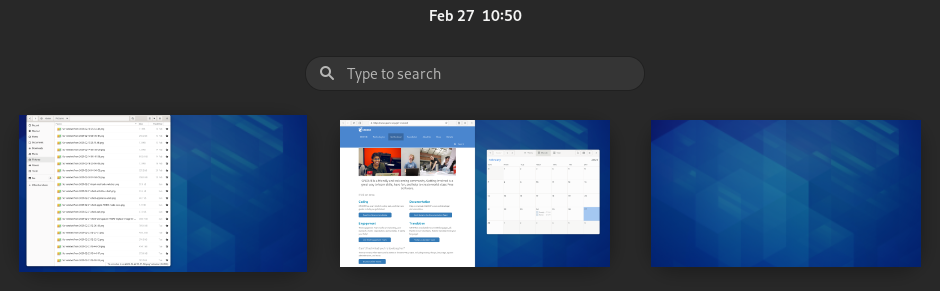

# Mutter, fenêtres, décorations et écrans



Mutter est le compositeur et gestionnaire de fenêtres utilisé par GNOME Shell. Il gère les fenêtres, leur placement, les espaces de travail, les écrans et la composition graphique. Le thème GNOME Shell ne contrôle pas tout ce qui apparaît autour d'une fenêtre.

## 1. Les couches à distinguer

### Décoration côté client (CSD)

Avec une décoration côté client (*Client-Side Decorations*), l'application dessine elle-même sa barre de titre et ses contrôles. Une application GTK 4 ou Libadwaita utilise souvent une barre d'en-tête intégrée. Son apparence dépend principalement du CSS de l'application et de son toolkit.

### Décoration côté serveur (SSD)

Avec une décoration côté serveur (*Server-Side Decorations*), le gestionnaire de fenêtres fournit une partie de la décoration. Le rendu dépend du protocole, du compositeur et de l'application. Un thème GTK ne modifie pas nécessairement une décoration SSD.

### GNOME Shell

Le Shell dessine le panneau, la vue Activités, les menus, les OSD, les dialogues du Shell et certaines interfaces de gestion des fenêtres. Ces éléments utilisent le thème Shell.

### Mutter

Mutter gère le placement, les tailles, les contraintes, les espaces de travail, les moniteurs et la composition. Une grande partie de ce comportement n'est pas une propriété CSS.

## 2. Identifier le propriétaire d'un élément

Avant d'écrire une règle, observez l'élément :

- barre de titre et boutons intégrés à l'application : probablement CSD ;
- bordure et barre de titre autour de la surface applicative : possiblement SSD ;
- panneau, vue Activités ou Alt-Tab : GNOME Shell ;
- position, taille, espace de travail ou sortie écran : Mutter ou réglages d'affichage.

Identifiez le processus et le moteur qui dessinent l'élément. Un sélecteur CSS n'est utile que si la feuille de style correspondante est chargée par ce moteur.

## 3. Personnaliser une barre d'en-tête GTK

Pour une application GTK 4, inspectez la barre d'en-tête avec GTK Inspector. Exemple de règles pour une application qui utilise les classes GTK standard :

```css
headerbar {
  min-height: 42px;
  padding: 4px 8px;
}

headerbar button {
  border-radius: 999px;
}

headerbar .title {
  font-weight: 700;
}
```

Cet exemple concerne GTK, pas Mutter. Certaines applications ajoutent leurs propres classes ou dessinent une barre personnalisée. Pour Libadwaita, respectez ses variables sémantiques et vérifiez séparément les variantes claire et sombre.

## 4. Aperçus de fenêtres dans le Shell

Les aperçus de la vue Activités et du sélecteur Alt-Tab sont des acteurs du Shell, pas les fenêtres originales. Les modifier ne change pas la taille réelle de la fenêtre.

Consultez [Vue Activités](14-vue-activites-overview.md), [OSD, dialogues et Alt-Tab](17-osd-dialogues-alt-tab-capture.md) et [Inspection CSS](12-inspection-et-diagnostic-css.md).

## 5. Espaces de travail et réglages Mutter

Listez les schémas disponibles :

```bash
gsettings list-schemas | grep -E 'mutter|wm|desktop.wm'
gsettings list-recursively org.gnome.mutter
```

Toutes les clés ne sont pas présentes sur toutes les distributions. Certaines options peuvent être expérimentales ou réservées à une version particulière. Avant de modifier une clé, lisez sa description :

```bash
gsettings describe org.gnome.mutter nom-de-cle
```

Remplacez le nom fictif par une clé réellement listée sur votre système. Ne modifiez pas une préférence dont vous ne connaissez pas l'effet.

## 6. Écrans, HiDPI et mise à l'échelle

La taille visuelle dépend de la résolution physique, du facteur d'échelle logique, de la mise à l'échelle fractionnaire, des métriques du toolkit, de la taille de police et des dimensions minimales du composant.

Un bouton trop petit sur un écran HiDPI n'a pas nécessairement besoin d'une règle CSS plus grande. Vérifiez d'abord l'échelle du bureau et la taille logique du composant.

Testez au minimum un écran standard, un écran HiDPI, une mise à l'échelle fractionnaire si disponible, un écran externe et le déplacement d'une fenêtre entre deux écrans.

## 7. Wayland et X11

Wayland et X11 n'exposent pas les mêmes mécanismes de gestion des fenêtres. Sous Wayland, le compositeur contrôle les surfaces et la session. Sous X11, certains outils historiques peuvent interroger ou modifier plus largement les fenêtres.

Un thème CSS peut rester identique, mais le comportement des fenêtres et de certaines extensions peut différer. Testez les deux sessions si votre distribution les propose. Ne transposez pas automatiquement un résultat observé sous X11 à Wayland.

## 8. Bordures et ombres

Les ombres peuvent provenir du toolkit, des décorations CSD, de Mutter, des aperçus Shell ou d'un effet propre à l'application. Modifier une ombre GTK n'agit pas sur une ombre dessinée par Mutter. Modifier le thème Shell n'altère pas nécessairement les ombres des applications.

Supprimer toutes les ombres peut rendre les fenêtres difficiles à distinguer sur un fond uniforme. Identifiez leur propriétaire et conservez une séparation visuelle suffisante.

## 9. Dépannage

### Les boutons de titre ne changent pas

Vérifiez si la fenêtre utilise une CSD et inspectez son CSS. Les boutons peuvent avoir des classes propres à l'application.

### Les fenêtres ne se redimensionnent plus

Retirez les règles qui imposent des dimensions minimales ou fixes excessives. Le CSS ne doit pas empêcher le toolkit de respecter les contraintes de fenêtre.

### Les tailles varient entre deux écrans

Vérifiez l'échelle et les métriques logiques. Ne corrigez pas un problème d'échelle globale en ajoutant une taille fixe à chaque composant.

### Le résultat diffère sous Wayland

Identifiez les fonctions dépendantes du gestionnaire de fenêtres et des protocoles. Testez dans la session réellement ciblée.

## 10. Exercices

1. Ouvrez une application GTK 4 et inspectez sa barre d'en-tête.
2. Ouvrez la vue Activités et Alt-Tab pour distinguer les aperçus Shell des fenêtres réelles.
3. Comparez le rendu sur deux facteurs d'échelle.
4. Si Wayland et X11 sont disponibles, comparez la gestion des fenêtres sans modifier les réglages système.

## 11. Sources officielles

- [Mutter — code source](https://gitlab.gnome.org/GNOME/mutter)
- [Mutter — documentation](https://mutter.gnome.org/)
- [GNOME Shell 51.0](https://gitlab.gnome.org/GNOME/gnome-shell/-/tree/51.0)
- [GTK 4 — CSS overview](https://docs.gtk.org/gtk4/css-overview.html)
- [GTK 3 — CSS overview](https://docs.gtk.org/gtk3/css-overview.html)
- [Libadwaita — styles et apparence](https://gnome.pages.gitlab.gnome.org/libadwaita/doc/1-latest/styles-and-appearance.html)
- [Wayland — documentation](https://wayland.freedesktop.org/)

Mutter n'est pas un moteur CSS. Ne cherchez pas un sélecteur pour une fonction de placement, de composition ou de protocole qui n'est pas dessinée par GTK ou GNOME Shell.

## 12. Identifier précisément CSD, SSD et les décorations mixtes

Ne déduisez pas le type de décoration à partir du seul aspect de la fenêtre. Une application peut dessiner sa barre d'en-tête tout en laissant au compositeur une bordure ou une ombre. Elle peut aussi proposer une décoration différente selon la session ou le backend.

Procédez dans cet ordre :

1. Identifiez l'application, son paquet et sa version.
2. Repérez si la barre d'en-tête appartient à la fenêtre GTK ou à une décoration externe.
3. Inspectez la barre avec GTK Inspector si elle appartient au toolkit.
4. Comparez avec une application qui utilise une décoration serveur dans la même session.
5. Recommencez sous Wayland et X11 lorsque les deux sessions sont disponibles.
6. Consignez séparément barre de titre, boutons, bordure, ombre et ombrage de redimensionnement.

Une règle `headerbar` agit sur le widget GTK qui porte ce nom ; elle ne modifie pas la décoration SSD du gestionnaire de fenêtres. De même, une règle du thème Shell ne transforme pas les contrôles de titre dessinés par l'application.

## 13. Observer la fenêtre et son environnement

Les outils disponibles varient selon la session. Sous X11, des utilitaires comme `xprop` peuvent fournir des propriétés de fenêtre. Sous Wayland, l'accès aux informations globales des surfaces est volontairement plus limité ; les outils X11 ne constituent donc pas une méthode universelle.

Pour relever l'environnement sans modifier la configuration :

```sh
printf 'Session : %s\\n' "$XDG_SESSION_TYPE"
printf 'Type de bureau : %s\\n' "$XDG_CURRENT_DESKTOP"
printf 'Écran :\\n'
gsettings get org.gnome.desktop.interface scaling-factor 2>/dev/null || true
```

Le facteur d'échelle de l'interface n'est pas une mesure exhaustive de tous les réglages d'affichage. Relevez aussi la résolution et la mise à l'échelle affichées dans Paramètres > Écrans. Pour une campagne reproductible, notez la configuration de chaque moniteur, leur disposition et le moniteur principal.

Sous X11 seulement, si l'outil est installé :

```sh
xprop
```

Cliquez ensuite sur la fenêtre cible et examinez les propriétés disponibles. Ne recopiez pas les identifiants de fenêtre dans un rapport public si ceux-ci révèlent des détails personnels. Sous Wayland, utilisez les informations exposées par GNOME et les outils de diagnostic prévus par la session.

## 14. Sauvegarder et restaurer une préférence Mutter

Avant de modifier une préférence, relevez sa valeur initiale. La procédure suivante ne suppose pas qu'une clé donnée existe :

```sh
schema=org.gnome.mutter
gsettings list-keys "$schema"
gsettings list-recursively "$schema" > "$HOME/mutter-settings-before.txt"
```

Lisez la description et le type d'une clé avant de la modifier :

```sh
gsettings describe "$schema" nom-de-cle
gsettings range "$schema" nom-de-cle
gsettings get "$schema" nom-de-cle
```

Remplacez `nom-de-cle` par une clé réellement listée. N'utilisez pas une valeur copiée d'une autre version sans vérifier le type et la plage.

Après un test, restaurez la valeur exacte notée au départ :

```sh
gsettings set "$schema" nom-de-cle 'valeur-initiale'
```

La valeur ci-dessus est un exemple de syntaxe, pas une valeur à appliquer telle quelle. Les valeurs chaîne, booléen, entier et tableau ont des syntaxes différentes. Si la clé accepte une valeur par défaut appropriée et que vous souhaitez explicitement revenir à cette valeur, vérifiez d'abord la documentation de la clé avant d'utiliser `gsettings reset`.

Pour comparer toutes les préférences du schéma après le test :

```sh
gsettings list-recursively "$schema" > "$HOME/mutter-settings-after.txt"
diff -u "$HOME/mutter-settings-before.txt" "$HOME/mutter-settings-after.txt"
```

Les différences doivent être expliquées. Ce relevé ne sauvegarde pas les paramètres d'écran ni les réglages d'autres schémas.

## 15. Tester les écrans et les facteurs d'échelle sans confondre les causes

Préparez une même fenêtre et une même page de contenu, puis vérifiez :
- moniteur unique à échelle standard ;
- écran HiDPI ;
- deux moniteurs avec résolutions différentes ;
- déplacement de la fenêtre d'un écran vers l'autre ;
- changement d'orientation si le matériel le permet ;
- mise à l'échelle fractionnaire lorsque la session la prend en charge ;
- déconnexion puis reconnexion d'un écran externe.

Pour chaque cas, notez résolution, échelle, taille logique de la fenêtre, taille des polices et session. Comparez des captures réalisées avec les mêmes dimensions logiques. Une capture en pixels physiques ne suffit pas à comparer deux facteurs d'échelle différents.

Ne compensez pas une mauvaise configuration d'affichage en augmentant arbitrairement toutes les dimensions CSS. Vérifiez d'abord si le défaut vient de l'échelle, d'une métrique du toolkit, d'une taille minimale de fenêtre ou d'une règle de thème.

## 16. Diagnostic structuré des décorations

### La barre de titre ne répond pas au CSS

Vérifiez si elle est dessinée par GTK, Libadwaita, l'application ou le compositeur. Inspectez le widget réel. Si elle est SSD, une règle GTK n'est pas le bon point d'intervention.

### La bordure change mais pas l'ombre

La bordure et l'ombre peuvent appartenir à deux couches différentes. Identifiez le propriétaire de chacune. Ne multipliez pas les règles `box-shadow` dans le thème GTK sans preuve que le widget dessine cette ombre.

### Les boutons de fenêtre sont différents selon les applications

Certaines applications utilisent une barre d'en-tête et des boutons GTK ; d'autres délèguent la décoration au serveur ou possèdent leurs propres contrôles. Documentez les groupes d'applications séparément.

### Le rendu change entre Wayland et X11

Vérifiez le type de décoration négocié, les extensions et les différences du gestionnaire de fenêtres. Le même CSS ne garantit pas que les deux sessions dessinent les mêmes éléments.

## 17. Compte rendu d'une campagne Mutter

Utilisez une fiche par combinaison application/session/écran :

```text
Application et version :
Paquet et origine :
Session : Wayland / X11
Toolkit :
Type de décoration : CSD / SSD / mixte / inconnu
Barre de titre :
Boutons :
Bordure :
Ombre :
Résolution :
Facteur d'échelle :
Moniteurs :
Réglages Mutter modifiés :
Valeurs initiales conservées :
Procédure de restauration :
Résultat :
Limites et éléments non testés :
```

La fiche doit distinguer les observations des hypothèses. Si le propriétaire d'un effet n'a pas été identifié, indiquez « inconnu » plutôt que d'attribuer son rendu à Mutter ou à GTK sans preuve.
