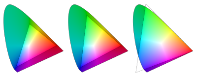

# Couleurs, profils d'écran et fidélité du rendu

Un thème peut définir les bonnes valeurs CSS et pourtant paraître différent d'un écran à l'autre. Le rendu final dépend du moteur graphique, du facteur d'échelle, des ressources raster ou vectorielles et du profil colorimétrique du moniteur.

Ce chapitre aide à distinguer un défaut du thème d'un problème de rendu ou de configuration d'écran.

## 1. Valeur CSS et couleur affichée

Une couleur déclarée dans une feuille CSS est une valeur interprétée par le moteur. La couleur observée dépend ensuite de la chaîne graphique et du périphérique d'affichage.

Pour comparer deux thèmes :
- utilisez le même écran ;
- conservez le même profil colorimétrique ;
- conservez la luminosité et les réglages du moniteur ;
- évitez de comparer une capture d'écran à une photo prise au téléphone ;
- vérifiez que les applications utilisent le même mode clair ou sombre.

Une capture PNG décrit les pixels capturés par le système. Une photo de l'écran inclut en plus le rétroéclairage, les reflets, l'exposition et le traitement de l'appareil photo.

## 2. Gestion des couleurs dans GNOME

GNOME fournit une page Couleur dans les paramètres sur les systèmes qui prennent en charge la gestion des profils. Elle permet d'associer des profils aux écrans et à certains périphériques.

Les profils sont des données de caractérisation du périphérique. Ils ne remplacent pas les couleurs CSS et ne doivent pas être distribués dans un thème comme s'il s'agissait de sa palette.

Un profil incorrect peut rendre les comparaisons visuelles trompeuses. Avant de retoucher une couleur, vérifiez le profil d'écran actif.

## 3. Distinguer les espaces colorimétriques

Un espace colorimétrique définit comment interpréter des valeurs de couleur. Deux valeurs RGB identiques n'ont pas nécessairement le même sens si elles sont interprétées dans des espaces différents.

Pour les interfaces, travaillez avec une palette cohérente et documentez l'espace utilisé par vos ressources. Pour les captures et les images distribuées, conservez les métadonnées de profil lorsqu'elles sont nécessaires et évitez les conversions successives sans contrôle.

Les profils ICC concernent le rendu et la conversion des couleurs. Ils ne constituent pas un moyen de forcer une couleur particulière dans une application qui utilise son propre rendu.

## 4. Contraste et lisibilité

Une palette visuellement agréable n'est pas forcément accessible. Vérifiez séparément :
- texte principal sur surface principale ;
- texte secondaire ;
- texte sur accent ;
- indicateur de focus ;
- bordures des champs ;
- états désactivés ;
- icônes fonctionnelles ;
- messages d'erreur et d'avertissement.

Ne réduisez pas l'opacité du texte pour simuler une hiérarchie si le contraste devient insuffisant. Une couleur de focus doit rester visible sur les surfaces claires, sombres et accentuées.

Les recommandations WCAG sont un point de contrôle utile pour le contraste du contenu, mais les composants natifs et les exigences d'accessibilité doivent aussi être vérifiés avec les outils de la plateforme.

## 5. Échelles, pixels logiques et ressources

Les tailles CSS GTK et Shell sont exprimées dans le système de coordonnées du toolkit, pas nécessairement en pixels physiques du panneau.

Conséquences :
- un contrôle de 24 unités logiques peut occuper davantage de pixels physiques avec un facteur d'échelle supérieur ;
- une image raster de petite taille peut devenir floue si elle est agrandie ;
- les icônes SVG peuvent être rasterisées à la taille requise ;
- les ressources raster doivent prévoir des variantes de densité lorsque le format et le moteur le permettent.

Ne multipliez pas arbitrairement toutes les dimensions CSS par deux pour un écran HiDPI. Le facteur d'échelle est géré par la plateforme ; le thème doit respecter les unités logiques et les métriques du toolkit.

## 6. Icônes et netteté

Pour chaque icône, vérifiez :
- taille logique demandée ;
- résolution réelle du fichier ;
- densité de l'écran ;
- alignement sur la grille de pixels ;
- contraste avec le fond ;
- cohérence des traits entre tailles.

Une icône vectorielle n'est pas automatiquement meilleure : un dessin complexe peut perdre en lisibilité à 16 px. Une icône raster peut être parfaitement adaptée si elle existe aux bonnes densités.

Les icônes d'interface doivent suivre les conventions GNOME et Freedesktop. N'utilisez pas une capture d'écran comme icône d'application.

## 7. Captures et comparaison visuelle

Pour créer une référence reproductible :
1. fixez la résolution et le facteur d'échelle ;
2. sélectionnez le même profil d'écran ;
3. fixez le mode clair/sombre ;
4. stabilisez le contenu dynamique ;
5. capturez depuis le système, sans appareil photo externe ;
6. conservez l'image originale sans recompression destructive.

Une comparaison pixel à pixel est utile pour repérer les écarts, mais elle ne juge pas seule la qualité. L'anticrénelage, les polices, les animations et les contenus dynamiques peuvent générer des différences sans défaut réel.

## 8. Profil de test conseillé

Pour chaque thème publié, consignez :
- modèle ou classe d'écran utilisée pour le test ;
- résolution ;
- facteur d'échelle ;
- profil colorimétrique actif ;
- mode clair ou sombre ;
- version GNOME ;
- version GTK et Libadwaita ;
- captures originales ;
- limites connues.

Il n'est pas nécessaire d'imposer un modèle d'écran précis aux utilisateurs. Le but est de rendre les comparaisons et rapports de défaut reproductibles.

## 9. Exercices

### Exercice A — comparer deux profils

Affichez la même palette sous deux profils d'écran configurés et notez les différences perçues. Ne modifiez pas les valeurs CSS pendant l'expérience.

### Exercice B — vérifier un contraste

Testez le texte principal, secondaire, les boutons et les états de focus sur les variantes claire et sombre.

### Exercice C — HiDPI

Comparez les icônes et contrôles à facteur d'échelle standard et élevé. Identifiez les ressources raster qui deviennent floues.

### Exercice D — capture de référence

Réalisez deux captures avec le même état d'interface et vérifiez qu'elles sont comparables avant de lancer une comparaison automatique.

## 10. Références

- [GNOME — gestion des couleurs](https://help.gnome.org/users/gnome-help/stable/color.html)
- [GNOME Human Interface Guidelines](https://developer.gnome.org/hig/)
- [GTK 4 — unités et CSS](https://docs.gtk.org/gtk4/css-overview.html)
- [Freedesktop Icon Theme Specification](https://specifications.freedesktop.org/icon-theme/latest/)
- [WCAG — contraste](https://www.w3.org/WAI/WCAG22/Understanding/contrast-minimum.html)
