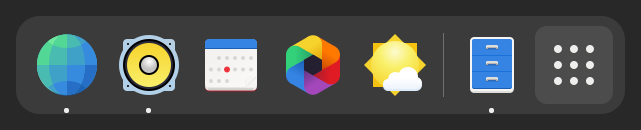
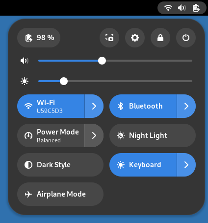
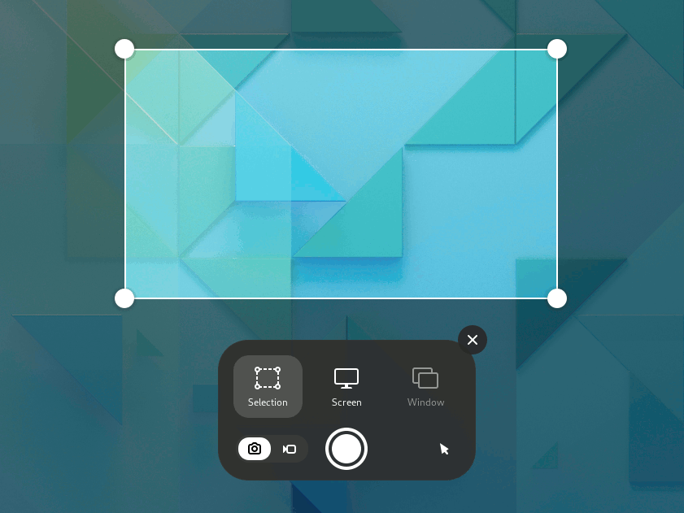
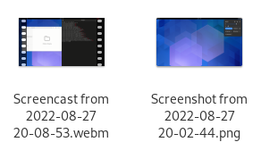
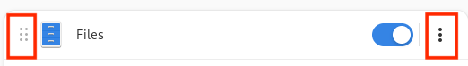
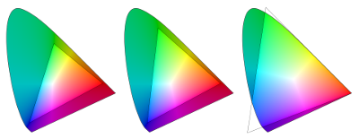

# Manuel de création et de personnalisation GNOME 51

Ce manuel accompagne un débutant depuis ses premières notions jusqu'à la création, la validation et la maintenance d'un thème GNOME. Il associe un parcours guidé, des ateliers, des références techniques, des exemples et des captures PNG locales.

Les cibles sont distinguées explicitement : GNOME Shell 51.0, GTK 3.24, GTK 4 et Libadwaita. Les applications Qt, Electron et Flatpak sont abordées pour expliquer les frontières de la thématisation. Les sélecteurs internes du Shell et les détails CSS des widgets peuvent changer : les sources de la version testée restent la référence.

## Comment lire ce manuel

Le manuel est organisé par objectifs plutôt que par une seule longue liste de chapitres.

- **Débuter** : comprendre les couches graphiques, installer un thème de test et apprendre les bases du CSS.
- **Pratiquer** : modifier un composant réel, observer son arbre CSS et valider le résultat.
- **Approfondir** : étudier les moteurs, les ressources, les extensions et les mécanismes système.
- **Consulter** : utiliser les inventaires et le glossaire comme références.

Les chapitres courts de synthèse introduisent un domaine. Lorsqu'un chapitre approfondi existe sur le même sujet, ce dernier contient les procédures détaillées et les exercices. Les chapitres de référence ne remplacent pas les ateliers.

## 1. Parcours débutant

1. [Bien démarrer](00-bien-demarrer.md)
2. [Architecture et périmètre de la personnalisation](01-architecture.md)
3. [Créer son premier thème complet](01-creer-premier-theme.md)
4. [Comprendre et écrire du CSS pour GNOME](02-css-debutant.md)
5. [Inspecter et diagnostiquer le CSS](12-inspection-et-diagnostic-css.md)
6. [Construire, installer et valider un thème](09-construction-validation.md)

Réalisez les exercices dans un dossier utilisateur de test. Ne remplacez pas les fichiers système et conservez toujours une méthode de retour arrière.

## 2. GNOME Shell : ateliers et composants

- [Atelier pratique : GNOME Shell 51](03-atelier-gnome-shell.md)
- [Panneau supérieur et indicateurs](13-panneau-superieur-shell.md)
- [Vue Activités, recherche et espaces de travail](14-vue-activites-overview.md)
- [Menus, réglages rapides, calendrier et notifications](15-menus-reglages-notifications.md)
- [Écran de verrouillage et GDM](16-ecran-verrouillage-gdm.md)
- [OSD, dialogues, Alt-Tab et capture d'écran](17-osd-dialogues-alt-tab-capture.md)
- [Clavier virtuel, IBus et accessibilité](18-clavier-ibus-accessibilite.md)
- [Composants Shell spécialisés](23-composants-shell-specialises.md)
- [Inventaire technique GNOME Shell 51](02-gnome-shell.md)
- [GNOME Shell 51.0 : inventaire pratique des sélecteurs du thème](43-inventaire-selecteurs-shell-51.md)
- [Catalogue pratique des composants](08-catalogue-pratique-composants.md)

Le Shell utilise St et Clutter, pas GTK. Pour un sélecteur, confirmez toujours le nœud et la classe dans GNOME Shell 51.0. Les noms internes ne sont pas une API stable.

## 3. GTK, Libadwaita et applications

- [Atelier pratique : GTK 3 et GTK 4](04-atelier-gtk.md)
- [Atelier pratique : Libadwaita](05-libadwaita.md)
- [Personnaliser les applications GNOME](11-applications-gnome.md)
- [GTK 3 en détail](19-gtk3-theming-detaille.md)
- [GTK 4 en détail](20-gtk4-theming-detaille.md)
- [Libadwaita en détail](21-libadwaita-theming-detaille.md)
- [CSS applicatif et ressources GResource](30-css-applications-gresource.md)
- [Applications Qt, Electron et environnements hybrides](38-applications-qt-electron.md)
- [Référence des widgets GTK et composants Libadwaita](03-gtk-libadwaita.md)
- [GTK 4.23 : variables CSS, requêtes de média et variantes d'interface](42-gtk-css-variables-requetes-media.md)

GTK 3, GTK 4 et Libadwaita ne sont pas interchangeables. Une application peut charger ses propres styles ou dessiner certains composants sans exposer de sélecteur utilisable par un thème global.

## 4. Ressources visuelles et rendu

- [Premiers pas avec les icônes, curseurs, polices et fonds](06-icones-curseurs-polices-fonds.md)
- [Créer et organiser les ressources d'un thème](22-ressources-icones-curseurs-polices-fonds-sons.md)
- [Thèmes d'icônes Freedesktop](32-themes-icones-freedesktop-detail.md)
- [Thèmes de curseurs Xcursor](33-themes-curseurs-xcursor-detail.md)
- [Fontconfig et typographie](34-fontconfig-typographie-detail.md)
- [Couleurs, profils d'écran et fidélité du rendu](31-couleurs-profils-ecrans-rendu.md)
- [Référence des ressources visuelles](06-ressources-visuelles.md)

## 5. Configuration, extensions et session

- [Paramètres GNOME, GSettings et dconf](05-parametres-gnome.md)
- [Installation, paramètres et dépannage](07-parametres-installation-diagnostic.md)
- [Extensions, Mutter, GDM et session](07-extensions-mutter-gdm.md)
- [Mutter, fenêtres, décorations et écrans](24-mutter-fenetres-decorations-ecrans.md)
- [Mutter 51 : réglages, fenêtres et diagnostic avancé](44-mutter-reglages-fenetres-diagnostic.md)
- [Décorations CSD et SSD : Wayland, X11 et Xwayland](45-decorations-csd-ssd-wayland-x11.md)
- [Développer une extension GNOME Shell 51](29-developper-extension-shell.md)
- [Thématisation des extensions GNOME Shell](39-thematisation-extensions-shell.md)
- [Thèmes GNOME et applications Flatpak](37-flatpak-themes-sandbox.md)
- [Accessibilité, mouvement, langue et densité](08-accessibilite.md)

Les paramètres GSettings ne sont pas des propriétés CSS. Les extensions peuvent ajouter leurs propres acteurs et feuilles de style. GDM et les décorations système sont des cibles distinctes du thème utilisateur.

## 6. Construire et maintenir un thème

- [Comprendre les moteurs CSS et leurs cascades](26-comprendre-moteurs-css-gnome.md)
- [Construire un thème Shell depuis les sources SCSS](27-construire-theme-shell-scss.md)
- [Moteur CSS St : cascade, sélecteurs et diagnostic](46-moteur-css-st-cascade-diagnostic.md)
- [Référence des propriétés CSS St 51](47-reference-proprietes-css-st-51.md)
- [Référence CSS GTK 4.23 et comparaison avec St](48-reference-css-gtk-423-comparaison-st.md)
- [Référence CSS GTK 3.24](49-reference-css-gtk3-324.md)
- [Référence Libadwaita 1.10 : variables et classes de style](50-reference-libadwaita-110.md)
- [Créer, installer et publier un thème](25-creer-installer-publier-theme.md)
- [Tests visuels, régressions et maintenance](28-tests-visuels-regression-maintenance.md)

Un thème doit être testé séparément sur chaque moteur qu'il annonce prendre en charge. Un CSS accepté par le parseur n'est pas une preuve que le sélecteur correspond ou que le rendu est correct.

## 7. Références techniques

- [Architecture et périmètre](01-architecture.md)
- [Inventaire GNOME Shell 51](02-gnome-shell.md)
- [GTK 3, GTK 4 et Libadwaita](03-gtk-libadwaita.md)
- [Référence CSS et compatibilité](04-reference-css.md)
- [GSettings et dconf](05-parametres-gnome.md)
- [Ressources visuelles](06-ressources-visuelles.md)
- [Extensions, Mutter, GDM et session](07-extensions-mutter-gdm.md)
- [Accessibilité et variantes](08-accessibilite.md)
- [Construction, installation et validation](09-construction-validation.md)
- [Sources officielles et inventaire](10-sources-et-inventaire.md)
- [Glossaire technique](40-glossaire-technique.md)
- [Cible de versions et compatibilité GNOME 51](41-versions-compatibilite.md)

## 8. Captures de GNOME standard

Les images suivantes sont des captures PNG locales copiées depuis le dépôt officiel [GNOME User Documentation, branche gnome-51](https://github.com/GNOME/gnome-user-docs/tree/gnome-51/gnome-help/C/figures). Leur provenance et leur licence sont décrites dans [le dossier des images](images/README.md). Elles illustrent l'interface standard et ne garantissent pas la présence d'un sélecteur CSS particulier.

- 
- 
- 
- 
- 
- 
- 
- 
- 
- 
- 

## 9. Périmètre et limites

Le manuel couvre les familles de composants natifs documentées pour GNOME Shell 51, GTK 3, GTK 4 et Libadwaita, ainsi que les ressources visuelles, paramètres GNOME, extensions et principales frontières avec les autres moteurs.

Il ne peut pas garantir la modification de chaque widget personnalisé de chaque application tierce. Certains composants sont dessinés par l'application, contrôlés par le compositeur ou protégés dans un contexte système. Ces limites sont indiquées afin de ne pas présenter une prise en charge inexistante comme une fonctionnalité du thème.

## 10. Formats exportés

Le PDF et l'EPUB sont générés à partir des chapitres Markdown et des captures locales. Le script d'export vérifie la présence des sources déclarées. La CI vérifie également l'intégration des chapitres, les images locales et les règles de formatage.
