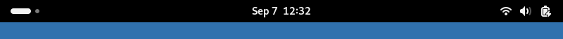
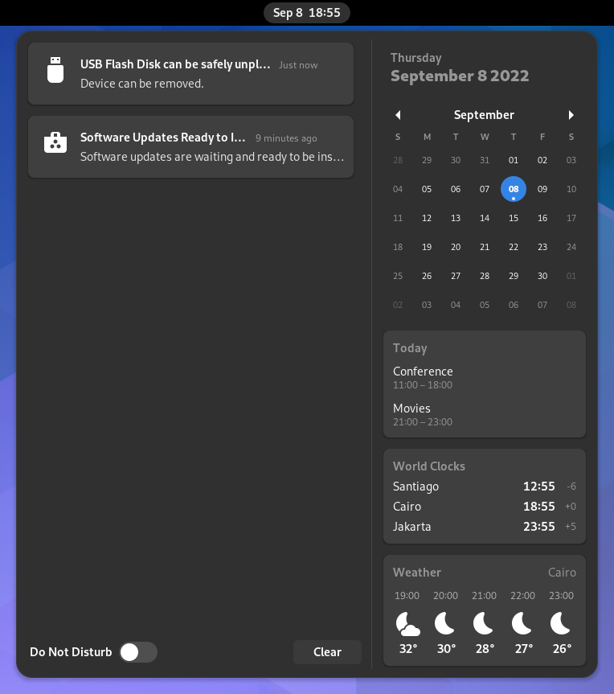
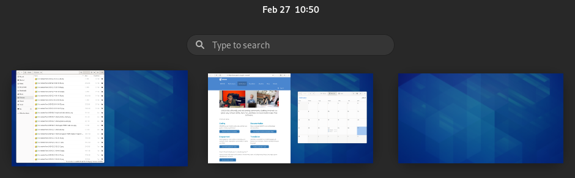
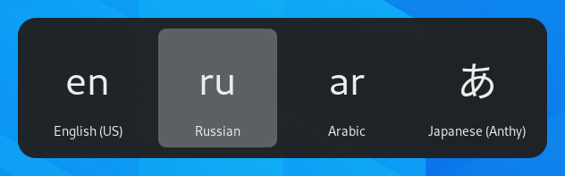

# Manuel de création et de personnalisation GNOME 51

Ce manuel accompagne un débutant depuis ses premières notions jusqu'à la création d'un thème GNOME structuré. Il comprend des tutoriels pratiques, des exemples, des exercices, des captures d’écran officielles GNOME légendées, des méthodes de diagnostic et un catalogue technique.

La documentation cible GNOME Shell 51.0, GTK 3.24, GTK 4 et Libadwaita. Elle combine un parcours guidé, des ateliers pratiques, des références de composants et des chapitres avancés pour comprendre les moteurs, construire les thèmes et maintenir leur compatibilité. Les sélecteurs Shell et les détails internes des widgets peuvent changer : vérifiez toujours la version installée.

## Parcours débutant — à lire dans l'ordre

1. [Bien démarrer](00-bien-demarrer.md)
2. [Créer son premier thème complet](01-creer-premier-theme.md)
3. [Comprendre et écrire du CSS pour GNOME](02-css-debutant.md)
4. [Atelier pratique : GNOME Shell 51](03-atelier-gnome-shell.md)
5. [Atelier pratique : GTK 3 et GTK 4](04-atelier-gtk.md)
6. [Atelier pratique : Libadwaita](05-libadwaita.md)
7. [Créer et modifier les ressources visuelles](06-icones-curseurs-polices-fonds.md)
8. [Paramètres GNOME, installation et dépannage](07-parametres-installation-diagnostic.md)
9. [Catalogue pratique des composants](08-catalogue-pratique-composants.md)
10. [Personnaliser les applications GNOME](11-applications-gnome.md)
11. [Personnaliser le panneau supérieur](13-panneau-superieur-shell.md)
12. [Personnaliser la vue Activités](14-vue-activites-overview.md)
13. [Menus, réglages rapides, calendrier et notifications](15-menus-reglages-notifications.md)
14. [Écran de verrouillage, déverrouillage et GDM](16-ecran-verrouillage-gdm.md)
15. [OSD, dialogues, Alt-Tab et capture d'écran](17-osd-dialogues-alt-tab-capture.md)
16. [Clavier virtuel, saisie, IBus et accessibilité](18-clavier-ibus-accessibilite.md)
17. [Personnaliser GTK 3 en détail](19-gtk3-theming-detaille.md)
18. [Personnaliser GTK 4 en détail](20-gtk4-theming-detaille.md)
19. [Personnaliser Libadwaita en détail](21-libadwaita-theming-detaille.md)
20. [Créer les ressources d'un thème](22-ressources-icones-curseurs-polices-fonds-sons.md)
21. [Composants Shell spécialisés](23-composants-shell-specialises.md)
22. [Mutter, fenêtres, décorations et écrans](24-mutter-fenetres-decorations-ecrans.md)
23. [Construire, installer, tester et publier un thème](25-creer-installer-publier-theme.md)
24. [Comprendre les moteurs CSS et leurs cascades](26-comprendre-moteurs-css-gnome.md)
25. [Construire un thème Shell depuis les sources SCSS](27-construire-theme-shell-scss.md)
26. [Tests visuels, régressions et maintenance](28-tests-visuels-regression-maintenance.md)
27. [Développer une extension GNOME Shell 51](29-developper-extension-shell.md)
28. [CSS applicatif et ressources GResource](30-css-applications-gresource.md)
29. [Couleurs, profils d'écran et fidélité du rendu](31-couleurs-profils-ecrans-rendu.md)
30. [Maîtriser les thèmes d'icônes Freedesktop](32-themes-icones-freedesktop-detail.md)
31. [Concevoir et diagnostiquer un thème de curseurs Xcursor](33-themes-curseurs-xcursor-detail.md)
32. [Maîtriser Fontconfig et la typographie](34-fontconfig-typographie-detail.md)
33. [Créer un thème avec l'éditeur visuel](35-editeur-visuel-tokens-projets.md)
34. [Aperçu GNOME Shell isolé avec Mutter](36-apercu-shell-imbrique-mutter.md)

## Captures de l'interface GNOME standard

Les images sont des captures d’écran PNG provenant du dépôt officiel [GNOME User Documentation](https://github.com/GNOME/gnome-user-docs/tree/gnome-51/gnome-help/C/figures), branche `gnome-51`. Elles montrent le bureau GNOME standard et ses composants réels. Les fichiers sont copiés dans le dépôt pour rendre le manuel autonome et consultable hors ligne.

- 
- 
- 
- 
- 
- 
- 
- 
- 
- 
- 

Les captures ne remplacent pas l’inspection de la version installée : les dimensions, les libellés et les sélecteurs internes peuvent évoluer.

## Compléments pédagogiques

- [Personnaliser les applications GNOME](11-applications-gnome.md)
- [Inspection et diagnostic CSS](12-inspection-et-diagnostic-css.md)
- [Panneau supérieur](13-panneau-superieur-shell.md)
- [Vue Activités](14-vue-activites-overview.md)
- [Menus, réglages rapides, calendrier et notifications](15-menus-reglages-notifications.md)
- [Composants Shell spécialisés](23-composants-shell-specialises.md)
- [Mutter et décorations](24-mutter-fenetres-decorations-ecrans.md)
- [Publication d'un thème complet](25-creer-installer-publier-theme.md)
- [Moteurs CSS et cascades](26-comprendre-moteurs-css-gnome.md)
- [Sources SCSS du thème Shell](27-construire-theme-shell-scss.md)
- [Tests visuels et maintenance](28-tests-visuels-regression-maintenance.md)
- [Développer une extension GNOME Shell](29-developper-extension-shell.md)
- [CSS applicatif et GResource](30-css-applications-gresource.md)
- [Couleurs et profils d'écran](31-couleurs-profils-ecrans-rendu.md)
- [Thèmes d'icônes Freedesktop](32-themes-icones-freedesktop-detail.md)
- [Thèmes de curseurs Xcursor](33-themes-curseurs-xcursor-detail.md)
- [Fontconfig et typographie](34-fontconfig-typographie-detail.md)

## Référence technique

- [Architecture et périmètre](01-architecture.md)
- [Inventaire GNOME Shell 51](02-gnome-shell.md)
- [GTK 3, GTK 4 et Libadwaita](03-gtk-libadwaita.md)
- [Référence CSS](04-reference-css.md)
- [GSettings et dconf](05-parametres-gnome.md)
- [Icônes, curseurs, polices, fonds et sons](06-ressources-visuelles.md)
- [Extensions, Mutter, GDM et session](07-extensions-mutter-gdm.md)
- [Accessibilité, mouvement, langue et densité](08-accessibilite.md)
- [Construction, installation et validation](09-construction-validation.md)
- [Sources officielles et inventaire](10-sources-et-inventaire.md)

## Comment utiliser ce manuel

Lisez d'abord le parcours débutant. Réalisez les exercices dans un dossier de test et ne modifiez pas les fichiers système. Pour un composant précis, consultez son tutoriel, observez la capture, puis vérifiez le sélecteur dans les sources correspondant à la version utilisée.

Chaque exemple est un point de départ. Un sélecteur CSS peut être valide sans correspondre à un composant présent. Une application peut charger son propre style. Les extensions peuvent ajouter des widgets et le thème utilisateur ne contrôle pas tous les moteurs.

## Couverture et limites

Le manuel vise les familles de composants natifs documentées pour GNOME Shell 51, GTK 3, GTK 4 et Libadwaita, ainsi que les ressources visuelles et paramètres GNOME. Il ne peut pas garantir la modification de chaque widget personnalisé de chaque application tierce, ni des écrans système protégés. Ces limites sont identifiées plutôt que masquées.

## Formats exportés

Le PDF et l'EPUB sont générés à partir des chapitres Markdown et des captures PNG locales du dépôt. Après chaque modification, reconstruisez les deux formats et vérifiez que les schémas et exemples sont présents.
